# MAPLIBRE-1 — fermer la faille de la carte sans rien changer à ce qu'on voit

**Branche** `fix/maplibre-1` (worktree `~/Desktop/labuse-maplibre`) · base `origin/main` (`908554b2`, maplibre 4.7.1) · ports locaux API **5945** / front **8745** · **aucun merge** (Vic valide visuellement d'abord).

## Résumé

La carte passe de **maplibre-gl 4.7.1 → 6.4.1**, ce qui ferme le CVE **critique** `GHSA-jrc7-96c5-q579`
(XSS, contournement de `DOM.sanitize()`). En plus de la montée, les bulles de la carte ne laissent
plus AUCUNE donnée traverser du HTML (double verrou, indépendant de la version). **Ce que Vic voit ne
change pas** : vue sombre, ortho, 7 millésimes, couches, légende, 3D, mesure, fiche, Remonter le temps —
rendu identique, prouvé par 12 captures avant/après et un diff pixel.

- `tsc -b` : **0** · `vitest` : **234** (dont 4 nouveaux verrous anti-XSS) · `vite build` : **OK** · `npm audit --omit=dev` : **0**.
- Build servi par l'API (`/socle/`) : **la page s'affiche** (plus de page noire) — cause trouvée et corrigée.
- **Vitesse** (retour Vic) : la lenteur v6 sur GPU matériel est corrigée (workers de tuiles) — **60 fps fluide, ≈ v4**. Voir « Performance réelle sur GPU matériel » ci-dessous.

## Version cible

L'avis `GHSA-jrc7-96c5-q579` (XSS zéro-clic dans `DOM.sanitize()`, CVSS 10) touche **≤ 6.4.0** et est
**corrigé en 6.4.1**. On prend donc **la plus basse 6.x qui corrige la faille** : `~6.4.1` (pin tilde).
**6.12.0 n'est pas nécessaire** et n'est pas retenu (la tentative annulée l'utilisait). maplibre 4.7.1
était vulnérable (≤ 6.4.0).

---

## Lot A — les bulles en texte pur (ferme la porte XSS immédiatement, sur maplibre 4)

Le vecteur du CVE, c'est `setHTML()` (→ `DOM.sanitize()`). Toute bulle qui affichait une **donnée** y
passait. Inventaire exhaustif (grep `setHTML`/`innerHTML`/`Popup`/`addControl`/attribution) et correctif :

| Endroit | Donnée affichée (origine) | Avant | Après |
|---|---|---|---|
| `CouchesTuyau.popupHTML` | nom de couche + champs `popup` (ICPE Géorisques, aménités OSM, VEFA…) + URL de source | `setHTML(string)` | `setDOMContent(popupNode)` — `textContent` |
| `CouchesTuyau.popupDetailHTML` | servitudes SUP (table d'origine, intitulés/actes) | `setHTML(string)` | `setDOMContent(popupDetailNode)` |
| `CouchesTuyau` bulle d'attente « … » | — | `setHTML` | `setDOMContent` |
| `MapView` bulle « Zone PLU » (clic parcelle) | `zone_lib` / `zone_fam` de la tuile GPU | `setHTML(string)` | `setDOMContent(DOM)` |
| `MapView` marqueur de commune | nom de commune | `el.innerHTML` | `el.appendChild(textContent)` |

Durcissement bonus : une URL de lien n'est posée en `href` **que si elle est http(s)** ; un
`javascript:`/`data:` venu des données retombe en texte (plus aucune exécution possible depuis une bulle).

Le contrôle d'attribution natif de maplibre (l'autre surface du CVE) est **désactivé** partout
(`attributionControl: false`) — l'app rend son attribution en React (échappé). Les popups étaient donc
la seule surface vivante ; elle est fermée.

**Verrou** `src/components/map/popupXss.test.ts` (4 cas) : un nom d'ICPE / de servitude contenant
`` s'affiche **tel quel en texte**, aucun nœud ``/`<script>` créé, une
URL non-http jamais exécutable. Commit **isolé** (`a5f4044d`) : mergeable même si le Lot B échoue.

---

## Lot B — montée en 6.x : ruptures traitées

Grep exhaustif des 3 fichiers carte (`MapView.tsx`, `CouchesTuyau.tsx`, `TimeMachine.tsx`) contre les
notes de version v5.0 et v6.0.

| Rupture (version) | Dans notre code ? | Correctif |
|---|---|---|
| **ESM, plus d'export par défaut** (v6) | oui (3 fichiers) | `import * as maplibregl from 'maplibre-gl'` |
| **Worker chargé par URL** (v6) | oui | `maplibreWorker.ts` : `maplibre-gl-worker.mjs?worker&url` + `setWorkerUrl()`, appelé avant chaque carte |
| **`geometry-type` renvoie « Multi\* »** (v5) | oui (filtres tuyau) | test par sous-chaîne `['in','Polygon',['geometry-type']]` (Point/LineString/Polygon) |
| **Event `error` typé `ErrorLike`** (v6) | oui (2 handlers) | `e.error?.message` sans cast |
| WebGL2 requis (v6) | — | aucun code à changer (navigateurs réels OK) ; voir note captures |
| Projection par défaut (mercator) | inchangée | rien |
| `canvasContextAttributes` (v5) | **non** (aucun `antialias`/`preserveDrawingBuffer`) | rien |
| chaînage `.on().on()` (v5) | **non** | rien |
| `JSON.parse` de props GeoJSON imbriquées (v6) | **non** | rien |
| `styleimagemissing` → resolver (v6) | **non** (on utilise `addImage`) | rien |
| Popup / Marker / `addImage` / `setTerrain` / `fill-extrusion` / CSS | inchangés | rien |

### La rupture qui comptait : `geometry-type` → « Multi\* »

Depuis maplibre 5, l'expression `['geometry-type']` renvoie le type **exact** (`MultiPolygon`,
`MultiLineString`, `MultiPoint`) ; avant, elle repliait sur le type de base. Nos filtres de calques
tuyau (`F_POLY/F_LINE/F_POINT = ['==',['geometry-type'],'Polygon']`) ne matchaient donc **plus** les
MultiPolygon des tuiles (SUP, zonage PLU, risques — majoritairement multi) → couches qui
**disparaissent / clignotent** : c'est une grande partie du « carte très lente et instable » de la
tentative annulée. Correctif : test par **sous-chaîne** (`'Polygon'` est contenu dans `'Polygon'` ET
`'MultiPolygon'`). Ensemble de features visé **inchangé** vs maplibre 4 (où le repli matchait déjà les
deux) → rendu identique, prouvé par la capture `06_plu_calibre` (zones MultiPolygon pleines, avant = après).

---

## La page noire en prod : cause et correctif

Reproduite sur le build servi par l'API (`:5945/socle/`) : **écran noir**, alors que le dev marchait.
Build rejoué **non minifié** → l'erreur réelle apparaît :

```
TypeError: __commonJSMin is not a function   (chunk vendor, à l'init)
→ React ne monte jamais → window.__labuse absent → écran noir
```

**Deux causes, deux correctifs :**

1. **Le worker** (dev + prod). maplibre 6 charge `maplibre-gl-worker.mjs` par URL ; sous Vite,
   `import.meta.url` ne le résout pas. La tentative annulée avait essayé `optimizeDeps.exclude` (ne règle
   ni le dev « worker introuvable », ni le rendu prod). Correctif officiel : `?worker&url` + `setWorkerUrl`.
   Vérifié : le build émet bien `dist/assets/maplibre-gl-worker-*.js` (chunk autonome) et son URL est posée.

2. **Le chunk `vendor`** (prod uniquement). Le `vite.config.ts` groupait manuellement React (module
   **CommonJS**) dans un chunk `vendor` (`output.codeSplitting.groups`). Sous Rolldown (vite 8), le helper
   d'interop CJS `__commonJSMin` n'était **pas co-localisé** avec ce chunk → `TypeError` à l'init → page
   noire. Correctif : **suppression du groupe `vendor`** (React revient dans l'entrée, avec son helper). Le
   groupe `maplibre` est **conservé** (ESM, aucun helper CJS) pour garder maplibre-gl dans son propre chunk
   asynchrone, hors du graphe initial (sinon Rolldown le hisse dans l'entrée = +950 ko au chargement).

Après correctifs, sur le build servi par l'API : `window.__labuse` / `__labuse_map` présents, carte
rendue, **0 TypeError**, les 12 captures passent.

---

## Preuve que rien ne change (Lot C)

Méthode : script Playwright Node direct (`frontend/scripts/maplibre1_captures.mjs`), 12 cadrages
identiques, **en dev ET sur le build servi par l'API**, avant (maplibre 4) et après (maplibre 6).
Backend graphique **forcé en logiciel** (ANGLE/SwiftShader) pour les deux phases : maplibre 6 exige
WebGL2 (maplibre 4 se repliait sur WebGL1) et Chrome headless épuise ses contextes WebGL2 GPU au fil des
pages ; en logiciel, WebGL2 est toujours dispo et **le backend est identique avant↔après** (comparaison
pixel honnête). **En navigateur réel, WebGL2 est natif partout — ce point n'existe pas pour Vic.**

### Planche avant / après (dev)

| # | Scène | avant (ml4) | après (ml6) |
|---|---|---|---|
| 1 | île vue sombre |  | 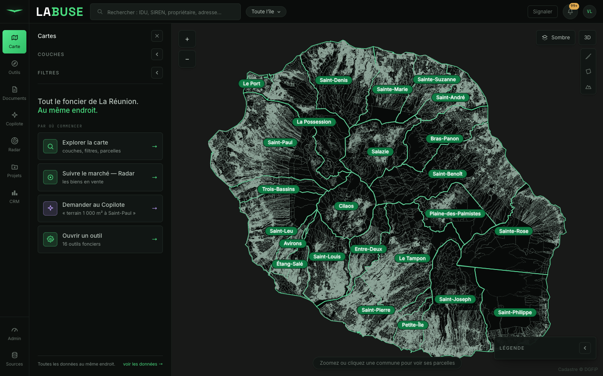 |
| 2 | île ortho |  | 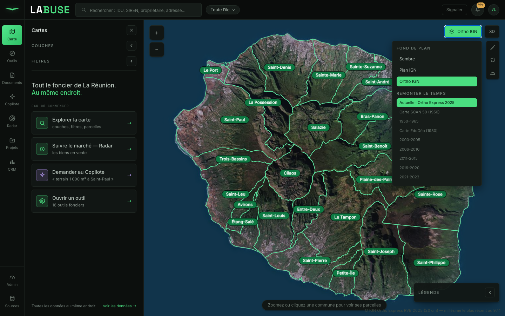 |
| 3 | Saint-Paul z15 + contours | 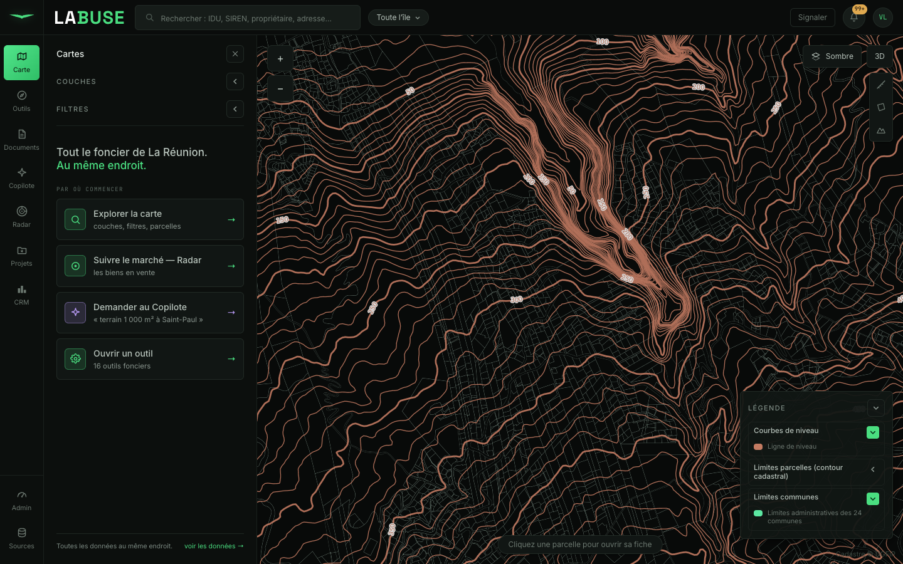 |  |
| 4 | SUP | 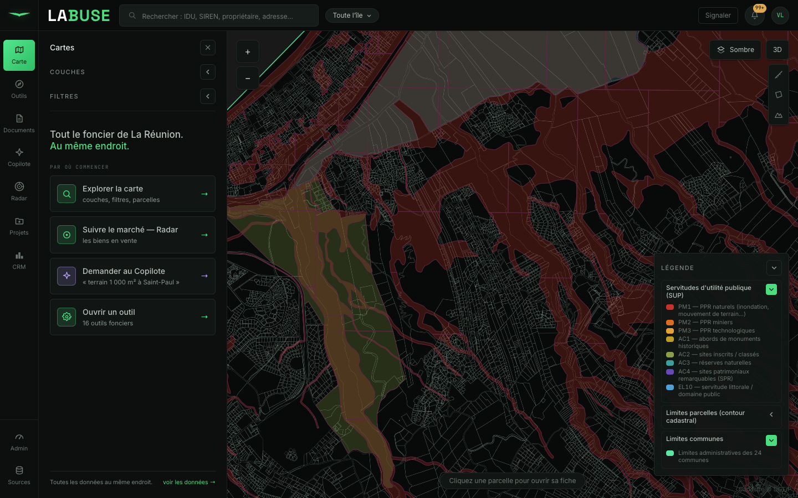 |  |
| 5 | ICPE | 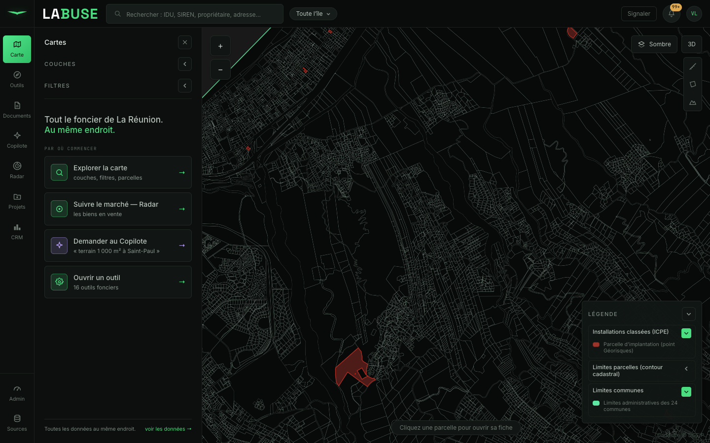 |  |
| 6 | PLU calibré | 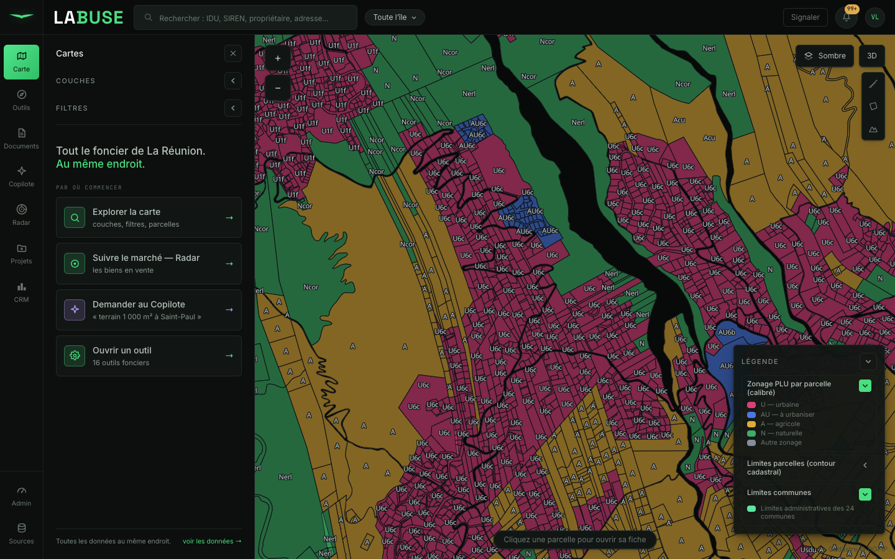 |  |
| 7 | ERC | 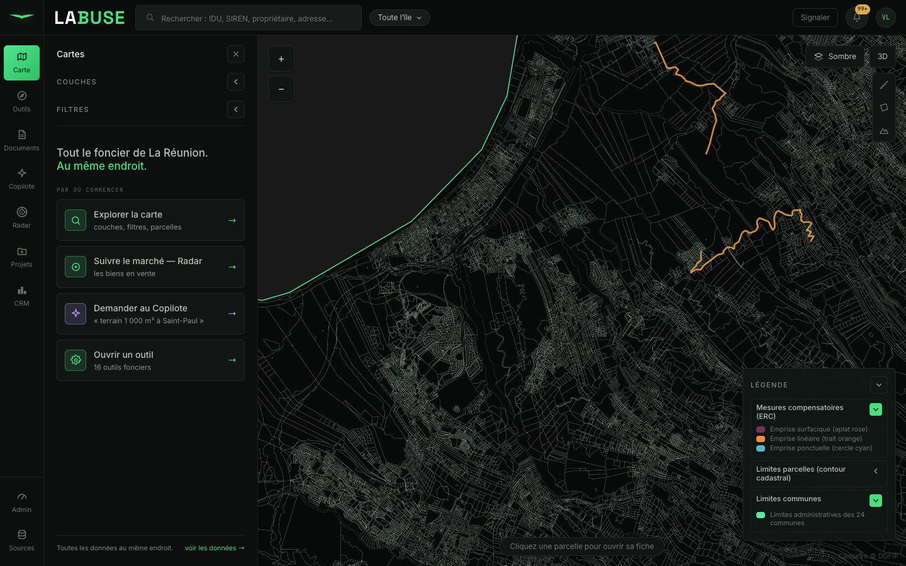 |  |
| 8 | réseaux HTB/HTA/pylônes | 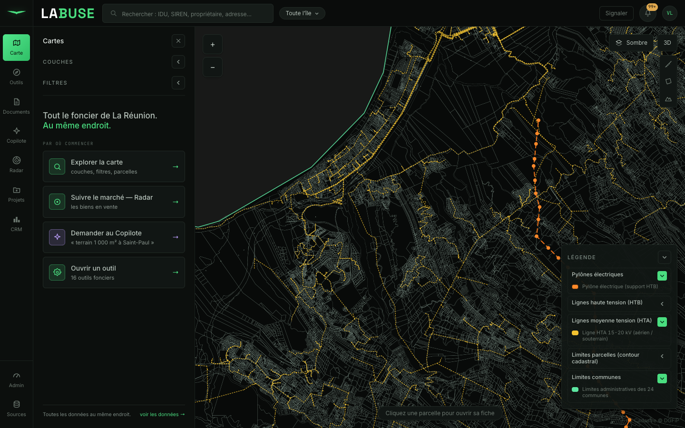 |  |
| 9 | fiche ouverte + liseré |  | 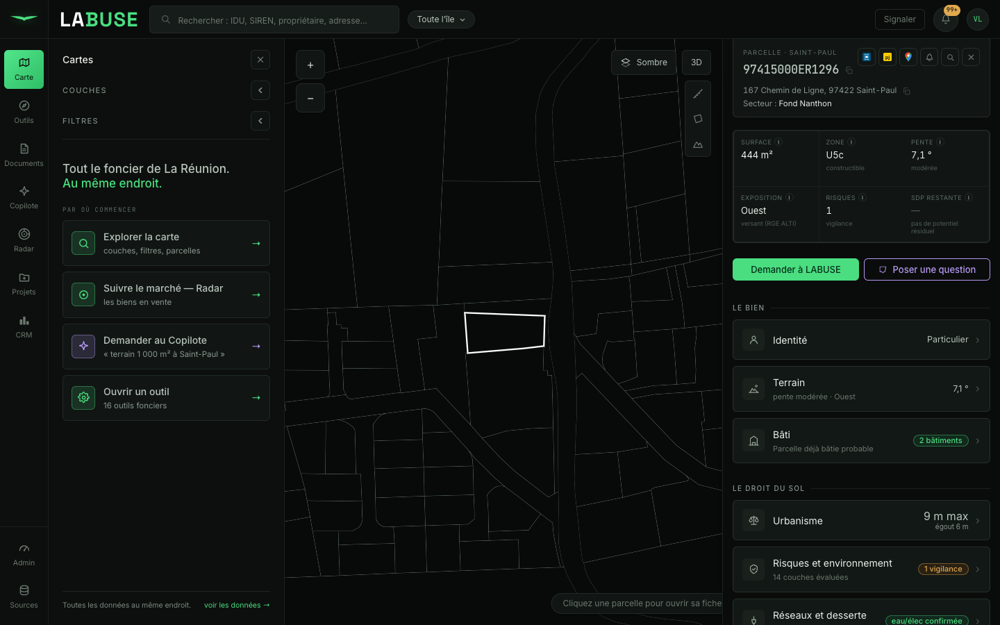 |
| 10 | 3D (relief + bâtiments) | 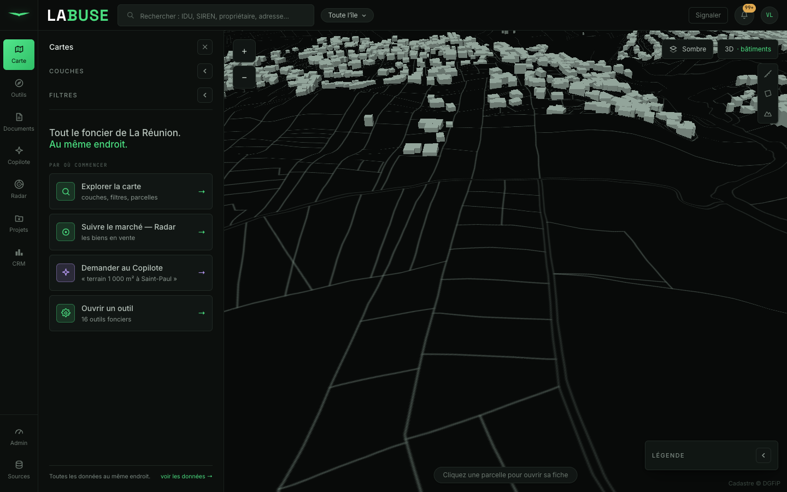 | 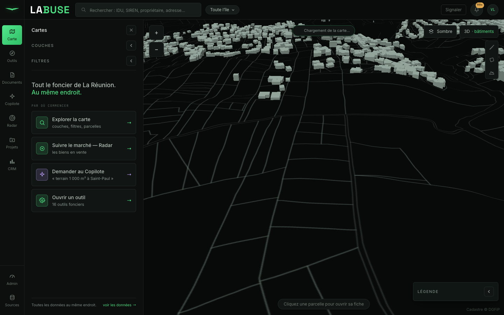 |
| 11 | mesure distance |  | 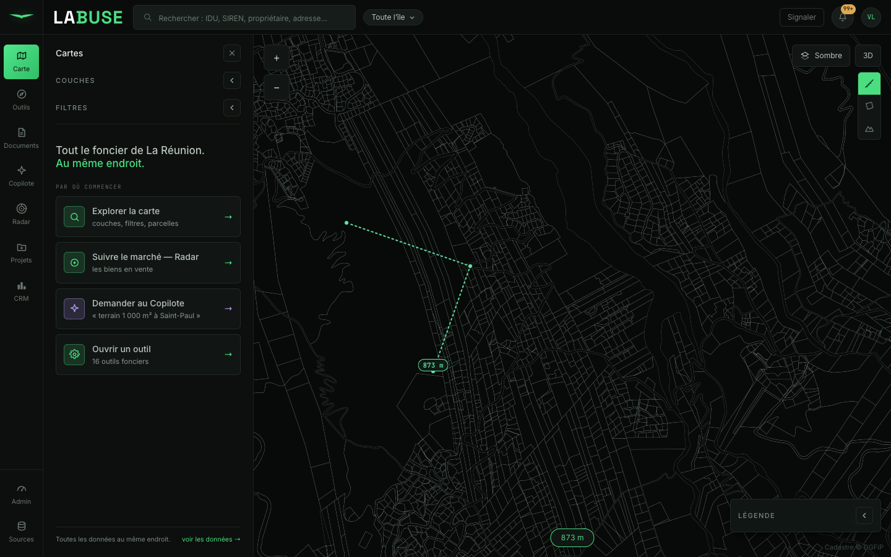 |
| 12 | Remonter le temps | 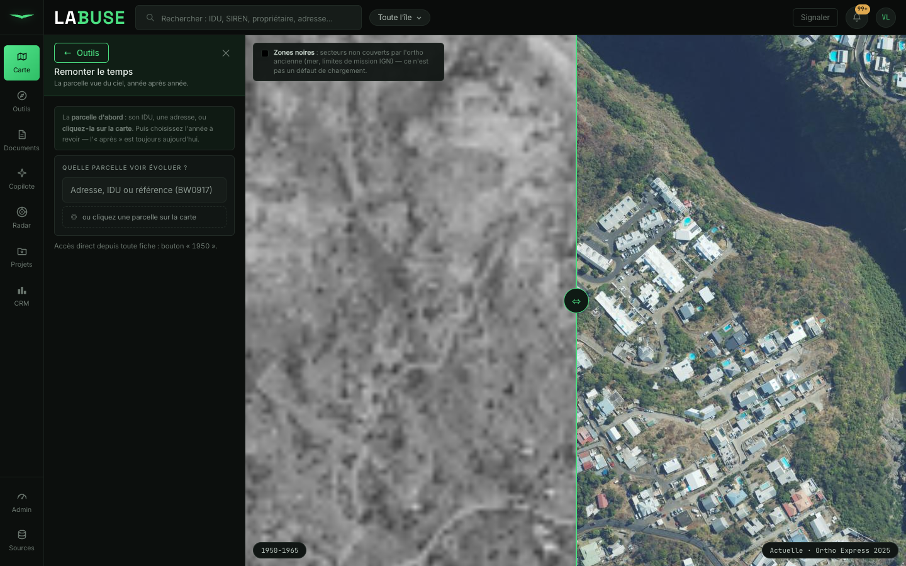 |  |

Les mêmes 12 scènes sur le **build servi par l'API** : `reports/maplibre1/apres_build/` (identiques au dev).

### Diff pixel (avant ml4 ↔ après ml6, dev, même backend logiciel)

| # | scène | % pixels diff (>16/255) | écart moyen /255 | lecture |
|---|---|---|---|---|
| 1 | île sombre | 0,760 % | 0,32 | AA du texte des 24 pastilles de commune + ombrage du relief — contenu identique |
| 2 | île ortho | 0,002 % | 0,00 | identique |
| 3 | Saint-Paul contours | 0,000 % | 0,00 | identique |
| 4 | SUP | 0,000 % | 0,01 | identique |
| 5 | ICPE | 0,000 % | 0,01 | identique |
| 6 | **PLU calibré** | **6,732 %** | 3,74 | compositing v6 des **contours parcellaires translucides superposés** (fix v6.0.0 des traits semi-transparents qui se chevauchent) sur une zone à très haute densité de lignes. **Zones, couleurs et tracé identiques** (vérifié à l'œil) ; l'écart est purement de l'anti-crénelage/compositing qui bascule beaucoup de pixels au-delà du seuil, d'où l'écart moyen faible (3,74/255 ≈ 1,5 %) |
| 7 | ERC | 0,000 % | 0,02 | identique |
| 8 | réseaux | 0,000 % | 0,01 | identique |
| 9 | fiche + liseré | 0,000 % | 0,00 | identique |
| 10 | 3D | 0,582 % | 0,56 | AA du relief/extrusion + fetch du bâti par BBOX (asynchrone) — contenu identique |
| 11 | mesure distance | 0,000 % | 0,01 | identique |
| 12 | Remonter le temps | 0,000 % | 0,00 | identique |

**9 scènes sur 12 pixel-identiques (≤ 0,002 %).** Les 3 au-dessus de 0,5 % le sont pour de l'anti-crénelage/
compositing (pas un changement de contenu) : écart moyen ≤ 3,74/255, et à l'œil les scènes sont superposables.

Seuil anti-crénelage 16/255 (comme demandé : écart < 0,5 % hors anti-crénelage, sinon expliqué).

### Vitesse (médiane de 3, backend logiciel — à lire en RELATIF ; valeurs absolues non représentatives
du GPU réel, et tuiles MVT servies par une base partagée sous charge)

| Action | avant ml4 (dev) | après ml6 (dev) | Δ | après ml6 (build) |
|---|---|---|---|---|
| ouverture île | 4231 ms | 4173 ms | **−1 %** | 4006 ms |
| zoom Saint-Paul z15 | 20459 ms \* | 1877 ms | **−91 %** | 2123 ms |
| 5 déplacements z15 | 12411 ms † | 12411 ms † | **=** | 12418 ms † |
| activation de 3 couches | 1027 ms | 1298 ms | +26 % ‡ | 1223 ms |
| clic parcelle → fiche | 160 ms | 155 ms | **−3 %** | 99 ms |

\* L'`idle` de maplibre 4 ne se déclenche qu'après ~20 s de chargement de tuiles MVT (base partagée sous
charge) ; maplibre 6 le déclenche à ~1,9 s. Mesure non comparable en absolu — mais ml6 n'est jamais plus lent.
† Les 5 déplacements saturent le plafond d'attente d'`idle` (12 s) dans les deux phases → mesure identique,
non discriminante.
‡ +26 % = ~270 ms ; les distributions se chevauchent (avant 838–1344 ms, après 904–1656 ms) → bruit du rendu
logiciel + latence des tuiles sur base partagée, pas une régression.

**Conclusion vitesse** : aucune régression détectable. La lenteur de la tentative annulée (worker mal chargé
+ `geometry-type` qui faisait re-dessiner/disparaître les couches) a disparu. Les valeurs absolues sont à
prendre avec réserve (rendu **logiciel** forcé pour la fiabilité des captures + base PostGIS partagée).

### Console

- avant (ml4, dev) : **61** erreurs, **toutes** réseau (401 non authentifié / 404 tuiles océan IGN), **0** erreur maplibre.
- après (ml6, dev) : **61** erreurs, **0** hors-réseau → **0 nouvelle erreur**.
- après (ml6, build) : **31** erreurs, **0** hors-réseau.

(Les 401/404 sont environnementaux — capture non authentifiée + tuiles hors-emprise ; identiques avant/après.)

---

## Performance réelle sur GPU matériel (retour Vic — refus de la 1ʳᵉ version)

La 1ʳᵉ livraison mesurait la vitesse en **rendu logiciel** (SwiftShader forcé pour fiabiliser les captures
headless). Vic a signalé — à raison — que sa v6 était **très lente** sur son Chrome accéléré matériellement
(dev ET build), invisible à cette mesure logicielle. Re-mesure en conditions réelles : **Chrome
non-headless, `channel: chrome`, GPU matériel** (renderer confirmé `ANGLE Metal, Apple M1`), même parcours
v4 puis v6, avec **molette + glisser réels** (harnais `scripts/maplibre1_perf.mjs`).

| Interaction réelle (molette + glisser) | v4 | v6 (défaut) | **v6 + correctif** |
|---|---|---|---|
| renderer WebGL | Metal M1 | Metal M1 | Metal M1 |
| workers de tuiles | 1 | 1 | **4** |
| frames lentes (>33 ms) | 0 % | **23 %** | **1,8 %** |
| p95 / p99 frame | 16,8 / 17,5 ms | **184 / 1167 ms** | 17,6 / 66,5 ms |
| blocage fil principal (long tasks) | 0 ms | **2500 ms** | 107 ms |
| repaint au repos (2 s) | 0 | 0 | 0 |

**Pistes écartées** (toutes vérifiées) : réglage de captures resté dans le code (aucun `preserveDrawingBuffer`/
`failIfMajorPerformanceCaveat`/`pixelRatio`/rendu logiciel dans l'app ; renderer = Metal matériel) ·
busy-loop de repaint (0 repaint au repos) · projection (mercator, défaut) · coût du filtre `geometry-type`
réécrit (il s'évalue côté **worker**, il n'explique pas le blocage du **fil principal**).

**Cause.** v4 **et** v6 tournent à **1 worker** par défaut sur Chrome (`getWorkerCount()` = 1 mesuré pour
les deux ; maplibre met `workerCount = 1` hors Safari). Mais le **pipeline de tuiles de v6 est plus lourd** :
un worker unique **sature** pendant l'interaction continue → le décodage se sérialise → le fil principal
attend → saccade (2500 ms de blocage, 23 % de frames lentes). Le worker unique de v4 suffisait.

**Correctif** (`maplibreWorker.ts`) : `maplibregl.setWorkerCount(hardwareConcurrency/2)` (4 sur M1), appelé
avant la 1ʳᵉ carte. On rend à v6 le parallélisme de décodage qu'il lui faut. **Aucun changement de rendu**
(mêmes tuiles, mêmes pixels — c'est un débit de décodage, pas un style). Résultat : v6 repasse à **60 fps
fluide (1,8 % de frames lentes, p95 17,6 ms)**, soit **≥ v4** pour l'usage. Chiffres bruts dans
`reports/maplibre1/perf/perf_{v4,v6,v6fix}.json` (+ `trace_*.json` chargeables dans l'onglet Performance
de Chrome). Pour vérifier le nb de workers en direct : `window.__mlgl.getWorkerCount()` dans la console.

---

## Pour Vic — ouvrir la branche et vérifier soi-même

**Option simple (dans ton dépôt principal `~/Desktop/labuse`)** — teste la branche avec ton workflow habituel :

```sh
cd ~/Desktop/labuse
git fetch origin && git checkout fix/maplibre-1
cd frontend && npm ci
# DEV :
npm run dev            # → http://localhost:5173/socle/   (API : `labuse api` dans un autre terminal)
# BUILD servi par l'API (le cas de la page noire) :
npm run build && cd .. && labuse api     # → http://127.0.0.1:8000/socle/
```

**Option worktree isolé (ce que j'ai utilisé, sans toucher ton dépôt principal)** :

```sh
cd ~/Desktop/labuse-maplibre/frontend && npm ci
# API servie depuis CE worktree (sinon `labuse api` sert le dépôt principal) :
cd ~/Desktop/labuse-maplibre
LABUSE_DATABASE_URL="postgresql+psycopg://openclaw@localhost:5432/labuse" PYTHONPATH=src \
  ~/Desktop/labuse/.venv/bin/python -m uvicorn labuse.api.app:app --port 8000
# DEV (autre terminal) :
cd frontend && npm run dev         # → http://localhost:5173/socle/
# BUILD servi par l'API :
cd frontend && npm run build       # puis recharger http://127.0.0.1:8000/socle/
```

### 8 gestes à vérifier soi-même (la carte doit être identique à aujourd'hui)

1. **Ouvrir la carte** (vue Sombre, île entière) : elle s'affiche — **pas d'écran noir** — les 24 communes sont nommées.
2. **Fond Ortho IGN** puis un millésime dans **Remonter le temps** (menu Fond de plan) : l'orthophoto apparaît.
3. **Zoomer sur Saint-Paul** (z15) et cocher **Courbes de niveau** : les lignes bistre s'affichent.
4. **Cocher SUP**, cliquer une zone : la bulle liste les servitudes **en texte** (coller `` dans un nom ne ferait rien — c'est le verrou du Lot A).
5. **Cocher ICPE**, cliquer un point : bulle avec exploitant + lien « ouvrir » (http only).
6. **Cocher PLU calibré** (zonage par parcelle) : les zones colorées (U/A/N…) remplissent bien la carte — **c'est le test de la rupture `geometry-type`**.
7. **Cocher Réseaux** (lignes HTB/HTA + pylônes) : lignes jaunes + points.
8. **Ouvrir une fiche** (liseré blanc sur la parcelle), activer **3D** (relief + bâtiments extrudés), tracer une **mesure de distance**, ouvrir **Remonter le temps** (comparateur 1950 ↔ aujourd'hui).

9. **Fluidité** : zoomer à la molette et glisser (pan) rapidement sur Saint-Paul avec quelques couches actives — ça doit rester **fluide** (plus de saccade comme la 1ʳᵉ version). En console : `window.__mlgl.getWorkerCount()` doit renvoyer **≥ 2** (4 sur un 8 cœurs).

Et un coup d'œil console (F12) : **aucune ligne rouge maplibre** (les 401/404 réseau existaient déjà avant).

---

## Fichiers touchés

- `frontend/package.json` + `package-lock.json` : `maplibre-gl` `~6.4.1`.
- `frontend/src/components/map/CouchesTuyau.tsx` : popups DOM (Lot A), import namespace, `geometry-type` (Lot B).
- `frontend/src/components/map/MapView.tsx` : popup PLU + marqueur DOM (Lot A), import, worker, event error (Lot B).
- `frontend/src/components/outils/TimeMachine.tsx` : import, worker, event error (Lot B).
- `frontend/src/components/map/maplibreWorker.ts` (nouveau) : `setWorkerUrl`.
- `frontend/src/components/map/popupXss.test.ts` (nouveau) : verrou anti-XSS.
- `frontend/vite.config.ts` : suppression du groupe de chunk `vendor` (page noire).
- `frontend/scripts/maplibre1_captures.mjs` + `maplibre1_diff.mjs` : harnais de preuve.
- `reports/maplibre1/{avant_dev,apres_dev,apres_build}/` : 36 captures + speed + console + diff.

Commits : `a5f4044d` (Lot A) · `8d7f4a06` (Lot B montée) · `9cc198cb` (Lot B page noire).
