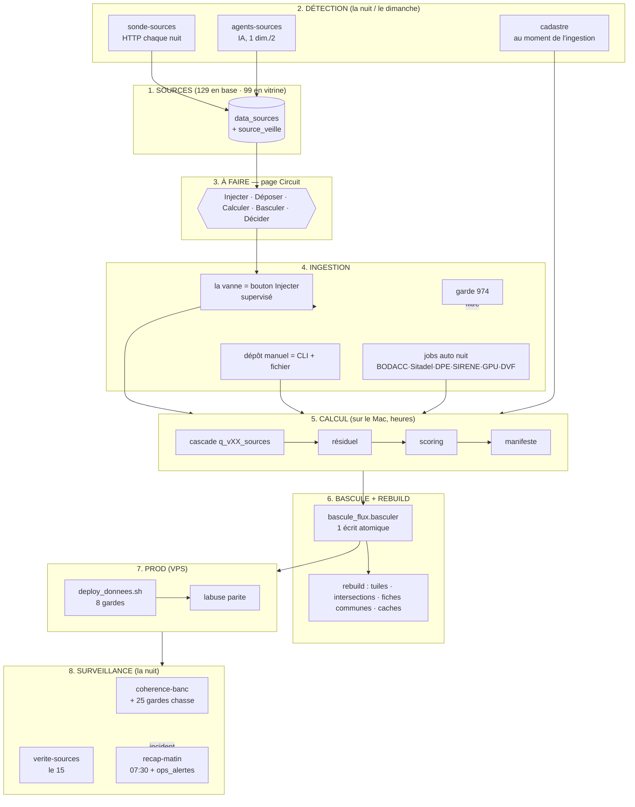

# COMMENT ÇA MARCHE — la donnée, de la source à l'écran

*DONNEES-ETAT-1 · lecture seule · pour Vic. Chaque chapitre dit : **qui déclenche** (cron / clic / CC à la main) · **où ça vit** (fichier, table) · **où on le voit** · **ce qui se passe ensuite**. Références `fichier:ligne` dans le dépôt.*

> **Flux Mac ⇄ VPS, la règle unique (décision 13/10, `docs/EXPLOITATION.md` §15).** Trois sens à ne jamais mélanger :
> 1. **Flux quotidiens** (BODACC, Sitadel, DPE, SIRENE, DVF) → **ingérés en prod la nuit**. **La prod fait foi** ; le Mac les récupère quand il recalcule.
> 2. **Sources de fond** (cadastre, PLU, risques, BAN, couches) → **construites sur le Mac** puis poussées en prod. **Le Mac fait foi.**
> 3. **Calculé** (scoring, résiduel, cascade) → **Mac → prod** par `sync-run.sh` (le Mac calcule, le VPS sert).

---

## 1. Les sources

- **Qui déclenche** : personne — c'est le catalogue. Rempli une fois (`labuse seed-sources`), tenu à jour par les étages suivants.
- **Où ça vit** : table `data_sources` (129 lignes) + `source_veille` (ce qu'on sait surveiller, ~98 lignes). Catalogue : `src/labuse/ingestion/seed_sources.py`. Règle d'affichage : `src/labuse/sources_catalog.py:38` (`WHERE_AFFICHEES`).
- **Où on le voit** : page client **Sources** (`frontend/src/components/sources/SourcesPage.tsx`) et onglet **Données** de l'admin.
- **Ce qui se passe ensuite** : une source a un **statut** (connectée, manuel, live, alias, retirée…) et un **mode de remplissage** (auto nuit, à-clic, dépôt manuel, en direct…). « Affichée » = statut connecté/manuel/live, pas doublon/retiré/dormant, pas désactivée : **99 en vitrine** + ~25 internes/partenaires. La **fraîcheur** n'est pas stockée fixe : elle est **recalculée à la lecture** (`src/labuse/etats_sources.py:68`) à partir de ce que la sonde a vu.

## 2. La détection (on repère qu'il y a du neuf, on n'ingère pas)

- **Sonde des sources** — `sonde-sources`, **chaque nuit 07:00**. Elle fait une requête HTTP sur chaque source interrogeable (millésime d'API, date d'un `GetCapabilities`, en-tête de fichier, ou empreinte d'une requête-témoin). Code : `src/labuse/sentinelle.py` + `src/labuse/jobs_impl.py` (sonde). Elle **écrit** `source_veille.dernier_statut` (`ok` / `nouvelle_version` / `injoignable` / `illisible`) et rafraîchit les colonnes de fraîcheur de `data_sources`. **Elle n'ingère rien** : elle prévient, Vic décide.
- **Agents de source (IA)** — `agents-sources`, **le dimanche soir, 1 semaine sur 2**, et **seulement si un plafond de dépense est posé** (`LABUSE_AGENT_PLAFOND_EUR`, défaut 0 = ne dépense rien → passage sauté). Pour les sources **sans amont lisible par la sonde**, un agent IA lit la page amont et dit s'il y a du neuf — **jamais sans une URL réellement citée avec une date** (`src/labuse/agent_source.py:154`, garde anti-invention). Écrit `source_agent_rapports` + (si « à jour »/« nouvelle ») `source_veille`.
- **Cadastre** — il n'y a **pas** de job de détection trimestrielle : le différentiel (parcelles nouvelles / modifiées / disparues) est **détecté au moment de l'ingestion**, faite à la main par CC (SOURCES-MAJ-1). Les disparues sont **marquées** `parcels.cadastre_disparue_le`, jamais supprimées (`src/labuse/cadastre_disparue.py`).

## 3. L'« À faire » (page Circuit)

- **Qui déclenche** : c'est une **vue calculée** à l'ouverture de la page. Composée par `src/labuse/circuit_resume.py:260` (`composer_a_faire`), servie par `src/labuse/api/dashboard.py:2397`, affichée par `frontend/src/components/admin/circuit/AFaire.tsx`.
- **Cinq gestes seulement** peuvent apparaître :
  - **Injecter** — une source est passée en « nouvelle version » (`circuit_resume.py:358`). Le bouton ouvre la source où se trouve sa **vanne** (voir §4).
  - **Déposer** — une source **manuelle échue** (cadence dépassée, `circuit_resume.py:398`). Le bouton **mène à la source** ; le dépôt lui-même est un geste CLI (voir §4).
  - **Calculer** — des entrées ont changé (résiduel à refaire) ou une règle PLU a bougé (`circuit_resume.py:371`). Lance le run.
  - **Basculer** — un run candidat est prêt (`circuit_resume.py:388`). **Désactivé** tant que « Calculer » n'est pas fait.
  - **Décider** — un verrou cassé, une fuite entre robinets, un écart, ou une sonde en panne (`circuit_resume.py:284`). Demande un arbitrage humain.
- **Ce qui se passe ensuite** : chaque geste est un **clic** qui déclenche l'étage correspondant. Rien ne part tout seul de cette page — elle liste, Vic agit.

## 4. L'ingestion (la donnée entre vraiment en base)

- **La vanne** = le bouton **« Injecter cette version »** sur la source (`src/labuse/api/dashboard.py:1680`). C'est le **pont supervisé** : il relance exactement la même commande d'ingestion que le cron, à la demande, et journalise qui a cliqué (`circuit_journal`). ⚠ **Il n'existe pas** de garde automatique « ±20 % de lignes » dans les connecteurs : la protection repose sur l'**idempotence** (`ON CONFLICT`/UPSERT) et la **sauvegarde quotidienne**, pas sur un seuil de volume. *(Le « guard ±20 % » de SOURCES-MAJ-1 était un garde-fou d'un script ponctuel, pas du code d'ingestion.)*
- **Les jobs auto de nuit** (`src/labuse/jobs_impl.py` → `src/labuse/ingestion/*`) :
  - `ingest-bodacc` (quotidien 06:40) → `bodacc_procedures` (UPSERT par annonce).
  - `ingest-sitadel` (mensuel le 10) → `sitadel_permits` (UPSERT par permis).
  - `ingest-dpe` (mensuel le 12) → `dpe_records` (UPSERT par n° DPE).
  - `ingest-sirene` (mensuel le 7) → `sirene_etablissements` (UPSERT par SIRET) + reconstruit `etablissement_parcelle`.
  - `sync-gpu` (mensuel le 15) → **ne ré-ingère pas** le PLU : il **diffe** les 24 PLU et pose un événement de veille + bandeau.
  - `ingest-dvf` (hebdo mardi) → recharge l'année DVF (DELETE année + réinsertion) si Etalab a publié.
- **Le dépôt manuel** : pour les 6 sources « dépôt manuel » (SPANC, PLH, Sudocuh, Office de l'eau, Radar, Loyers DHUP), il n'y a **pas d'upload dans le dashboard** — on dépose par une **commande CLI avec un fichier** (p. ex. `labuse ingest-mobpro --file …`). La tuile « Déposer » rappelle qu'il faut le faire et mène à la source.
- **La garde 974** (`src/labuse/ingestion/garde_974.py`) : à l'ingestion d'adresses/DPE, elle **rejette les homonymes métropolitains** (ex. « Saint-Leu 97436 » = Saint-Leu-la-Forêt, Val-d'Oise) en croisant code postal, nom de commune et coordonnées ; accepte s'il y a unanimité, rejette si deux critères se contredisent.

## 5. Le calcul (un « run », sur le Mac, plusieurs heures)

Enchaînement : **cascade → résiduel → scoring → manifeste**.
- **Cascade** `q_vXX_sources` — l'étage 0 : pour chaque parcelle, quels verdicts par couche. `labuse reevaluer-cascade --label …` (`cli.py:800`) écrit `dryrun_cascade_results`. ⚠ Le seul chemin qui rejoue la cascade par commune, `ingest-island`, **purge `parcels`** (`src/labuse/ingestion/run_all.py:59`) — à ne jamais lancer sur la base vivante.
- **Résiduel** — la capacité restante par parcelle. `labuse compute-residuel --new-run … --ile --assiette-clippee` (`cli.py:2478`) écrit `parcel_residuel_runs` (versionné par `run_seq`). Un garde **refuse d'écrire dans le run servi**.
- **Scoring** — `labuse score-labuse --run … --cascade-label … --signal-run …` (`cli.py:2559`) écrit `score_labuse` ; le Signal p_v2 (`scripts/audit/scoring/run_qvXX.py`) remplit `parcel_p_score_v2`.
- **Manifeste** — `config/served_manifest.json` : le **point de vérité** du run servi (scoring + cascade + résiduel + tuiles, et le précédent pour rollback). `src/labuse/manifeste.py`.

## 6. La bascule et le rebuild

- **Qui déclenche** : Vic, par le bouton **Basculer** (page Circuit) ou `labuse golden promote <run>` — alias de l'unique fonction `src/labuse/bascule_flux.py:318` (`basculer`).
- **Ce qui se passe** : un **seul écrit atomique** du manifeste déplace scoring + cascade + résiduel + tuiles + division ; l'ancien run devient « précédent » ; les **caches dépendants du run sont purgés** ; une garde de cohérence tourne **immédiatement** contre le nouveau run ; la bascule **commit** ses 3 fichiers pointeurs.
- **Le rebuild** (`src/labuse/fraicheur_caches.py:399`, `labuse rebuild`) régénère ce qui dérive du run : **tuiles** `mvt_parcels` (`api/tiles.py`), **intersections** `parcel_couche_intersection` (`couche_intersection.py`), **fiches communes** `commune_contexte_cache`, caches divers. Il est **automatique** après une bascule / un `residuel-serve` / un `deploy.sh` (clé de fraîcheur = run + cascade + résiduel + millésimes + code).

## 7. La prod (Mac → VPS)

- **`deploy/scripts/deploy_donnees.sh`** — la porte **unique** pour poser des données en prod, **8 gardes ordonnées**, arrêt au premier écart : sauvegarde fraîche & lisible → place disque (≥ 12 Go) → copie `--no-owner` + comptages/checksums Mac==prod (`sync-run.sh`) → intersections fraîches → **bascule en dernier** → contrôle du manifeste → `/readyz` 200 → **banc** (25 gardes + cohérence). `--no-bascule` = pose sans toucher les pointeurs.
- **`deploy/scripts/deploy_app.sh`** — déploie le code ; **refuse** si le manifeste local sert un run absent des données prod ; le manifeste servi est **exclu du rsync** (c'est le pointeur propre à la prod).
- **`deploy.sh`** — régénère **`/etc/cron.d/labuse` depuis le registre** (`labuse jobs`) et **refuse toute dérive** (édition à la main).
- **`labuse parite`** (`cli.py:271`) — compare les comptages Mac⟷prod **par sens** : un écart sur une table de **fond** = à corriger ; un écart sur une table **quotidienne** = informatif (prod ≥ Mac attendu).

## 8. La surveillance (la nuit, un mail le matin)

- **`coherence-banc`** (03:45) — rejoue chaque nuit, en interne contre la base servie : les comparaisons multi-lecteurs (COHERENCE-1), **les 25 gardes CHASSE-DONNÉES** (`scripts/coherence/chasse_donnees.py` via `src/labuse/chasse_banc.py`), puis les 1 000+ invariants générés. Résultats dans `coherence_runs` / `chasse_runs`. Un **faux-client nouveau** ou une garde en écart → incident.
- **`verite-sources`** (le 15, 06:00) — tire **20 parcelles au hasard** (stratifiées) et confronte la fiche servie aux **sources officielles en ligne** (cadastre IGN, Géorisques, DVF, bâtiments). `src/labuse/verite_sources.py` → `verite_sources_runs` ; tout écart ouvre un incident.
- **`recap-matin`** (07:30) — **un seul mail** : tout vert en une ligne, sinon la liste. Évalue les vigies sans point d'appel naturel (disque, `/readyz`, sauvegarde, copie externe, jobs en retard).
- **`ops_alertes`** (`src/labuse/ops_alertes.py`) — **la porte unique** : un incident = une alerte (mail Brevo + cloche admin), **un rappel/jour** au plus, puis un « résolu ». Table `ops_incidents`. Les vigies : échec de job, retard (1,5× cadence), disque, `/readyz`, sauvegarde absente/rétrécie, copie externe ancienne, garde chasse en écart, vérité-sources.
