# SONDAGE-10-LOT3 — dix règles tirées à GRAINE FIXE, prouvées par la page

ETUDE-STATIONNEMENT-FIX-1 (LOT 3). Tirage **déterministe** (non choisi) sur les 163 zones constructibles servies des communes à texte en base.

**Commande du tirage :**
```
PYTHONPATH=src python scripts/sondage_tirage.py --seed 20260121 --n 20
PYTHONPATH=src python scripts/sondage_images.py --seed 20260121 --n 20
```

Chaque règle : la valeur appliquée, la citation, l'article · page, et l'**image de la ligne entière** du PDF officiel.

## 1. 97402 — zone 1AUd (article UD 12.2 · p.62)
- **Valeur appliquée** : typologie : collectif 1/logt ; collectif 1.5/logt ; social 1/logt ; senior 0.3333/logt ; etudiant 0.3333/logt
- **Citation** : « Autres logements
1 place maximum par logement aidé
1 place par logement d’une surface de plancher ≤ 100 m²
1,5 places par logement d’une surface de plancher ≥ 100 m²
1 place de stationnement pour 3 chambres
pour les constructions à destination d'habitation, l'espace possède une superficie de 0,75 m² par logement
pour les logements jusqu'à deux pièces principales et 1,5 m² par logement dans les autres cas, avec une »
- **Preuve (image de la ligne, p.62) :**

  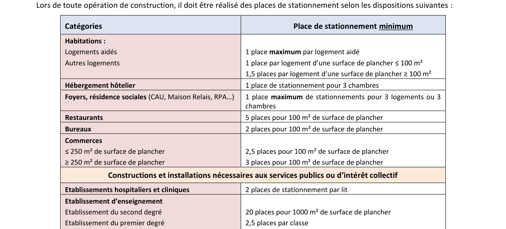

## 2. 97414 — zone UB (article UB 12.2 · p.37)
- **Valeur appliquée** : 2 place/logt (arr. superieur) · visiteur 0.5/1 logts
- **Condition(s) à vérifier** : les 0,5 place/logt au-delà de 10 logements sont des places PUBLIQUES (hors parcelle) — à vérifier
- **Citation** : « etc.). A titre indicatif, la superficie minimale d’une place de stationnement est de 25 m², y compris les
Habitations
Pour les logements sociaux
1 place de stationnement par logement
2 places de stationnement par logement
Pour les opérations de plus de 10 logements
1 place de stationnement pour deux chambres
1 place par tranche de 3 logements.
1 place visiteur par tranche de 5 logements.
1 place par tranche de 80 m² de service.
emplacement par logement,
pour les constructions à destination d’activités, un emplacement par tranche de 100 m² de surface
emplacements par tranche de 100 m² de surface de plancher pour les autres établissements, »
- **Preuve (image de la ligne, p.37) :**

  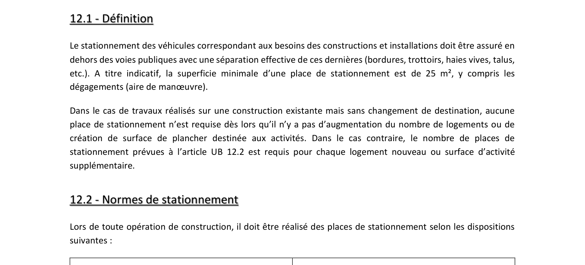

## 3. 97405 — zone UCe (article UC.12 · p.40)
- **Valeur appliquée** : 1 place/logt (arr. superieur)
- **Condition(s) à vérifier** : toute opération de logements collectifs : 20 % de l'espace de stationnement aérien doit être perméable — à vérifier
- **Citation** : « pour les constructions : 1 place de stationnement par logement ;
b) pour les logements locatifs financés par un prêt aidé de l’Etat : 1 place de stationnement
par logement, à l’exception du Logement Locatif Très Social (LLTS) où aucune place de
d) pour les hôtels et restaurants : 1 place de stationnement pour 2 chambres et 1 place de
0,75 m² par logement d’une ou deux pièces avec une superficie minimale de 3 m² ;
o  1,50 m² pour chaque logement de plus de deux pièces avec une superficie minimale
pour les constructions à usage de commerces et les activités artisanales : 1 place par tranche de »
- **Preuve (image de la ligne, p.40) :**

  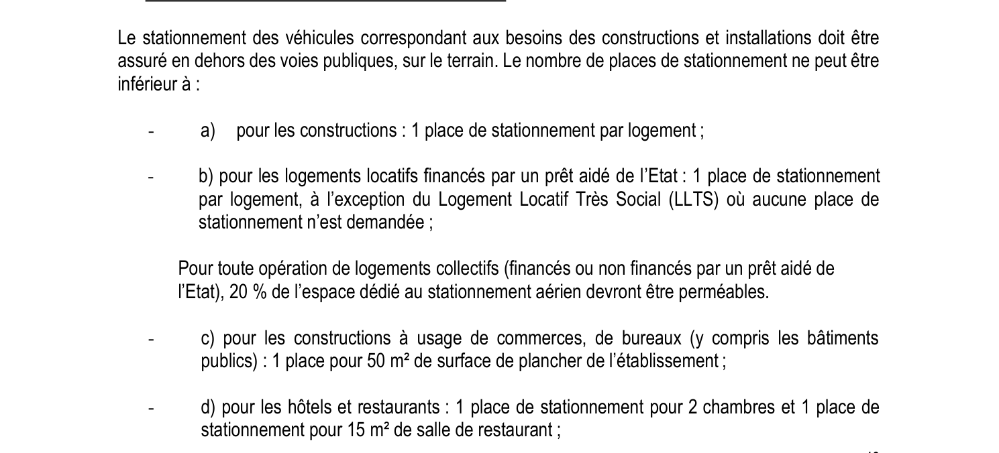

## 4. 97405 — zone UD (article UD.12 · p.50)
- **Valeur appliquée** : 1 place/logt (arr. superieur)
- **Condition(s) à vérifier** : toute opération de logements collectifs : 20 % de l'espace de stationnement aérien doit être perméable — à vérifier
- **Citation** : « a) pour les constructions à usage d’habitation : 1 place de stationnement par logement ;
b) pour les logements locatifs financés par un prêt aidé de l’Etat : 1 place de stationnement
par logement, à l’exception du Logement Locatif Très Social (LLTS) où aucune place de
Pour toute opération de logements collectifs (financés ou non financés par un prêt aidé de l’Etat), 20 %
d) pour les hôtels et restaurants : 1 place de stationnement pour 2 chambres et 1 place de
0,75 m² par logement d’une ou deux pièces avec une superficie minimale de 3 m² ;
o  1,50 m² pour chaque logement de plus de deux pièces avec une superficie minimale
pour les constructions à usage de commerces et les activités artisanales : 1 place par tranche de »
- **Preuve (image de la ligne, p.50) :**

  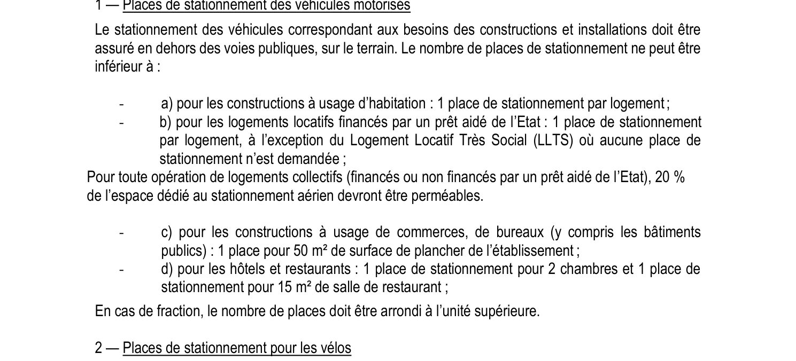

## 5. 97402 — zone Ua (article UA 12.2 · p.22)
- **Valeur appliquée** : typologie : collectif 1/logt ; collectif 1.5/logt ; social 1/logt ; senior 0.3333/logt ; etudiant 0.3333/logt
- **Citation** : « Autres logements
1 place maximum par logement aidé
1 place par logement d’une surface de plancher ≤ 100 m²
1,5 places par logement d’une surface de plancher ≥ 100 m²
1 place de stationnement pour 3 chambres
pour les constructions à destination d'habitation, l'espace possède une superficie de 0,75 m² par logement
pour les logements jusqu'à deux pièces principales et 1,5 m² par logement dans les autres cas, avec une »
- **Preuve (image de la ligne, p.22) :**

  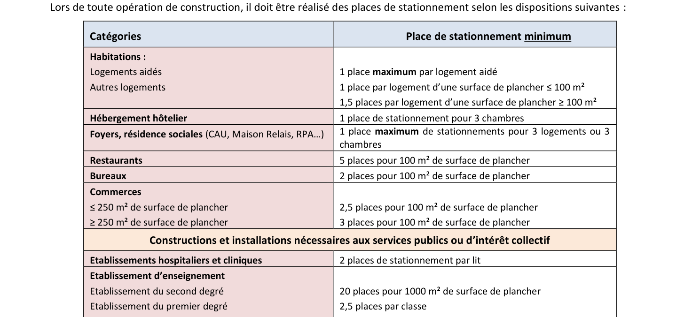

## 6. 97416 — zone Ucv (article Ucv6 · p.72)
- **Valeur appliquée** : 1 place / 75 m² (arr. inferieur)
- **Citation** : « Habitation
Logement
1 place de stationnement par tranche de
75 m² de surface de plancher.
0,85
place
de
stationnement
par
logement social
5 % de la surface de
plancher
pour
toute
construction de plus de
300 m² de surface de
plancher.
Hébergement
(résidences
personnes âgées,
étudiants, …)
0,2
place
de
stationnement
par
hébergement. »
- **Preuve (image de la ligne, p.72) :**

  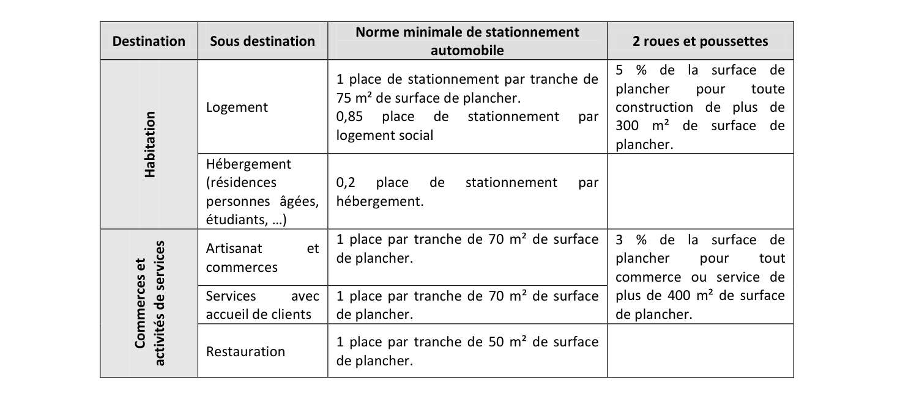

## 7. 97416 — zone AUg (article Ug6 · p.109)
- **Valeur appliquée** : 1.5 place/logt (arr. superieur)
- **Condition(s) à vérifier** : 0,5 place par parcelle pour les lotissements d'habitat individuel (espaces communs)
- **Citation** : « Habitation
Logement
1,5
place
de
stationnement
par
logement
1 place pour les logements locatifs
sociaux
0,5 place par parcelle, à réaliser au sein
des
espaces
communs,
pour
les
lotissements d’habitat individuel.
5 % de la surface de
plancher pour toute
construction de plus
de 300 m² de surface
de plancher
Hébergement
(résidences
personnes
âgées,
étudiants, …)
0,5
place
de
stationnement
par
hébergement »
- **Preuve (image de la ligne, p.109) :**

  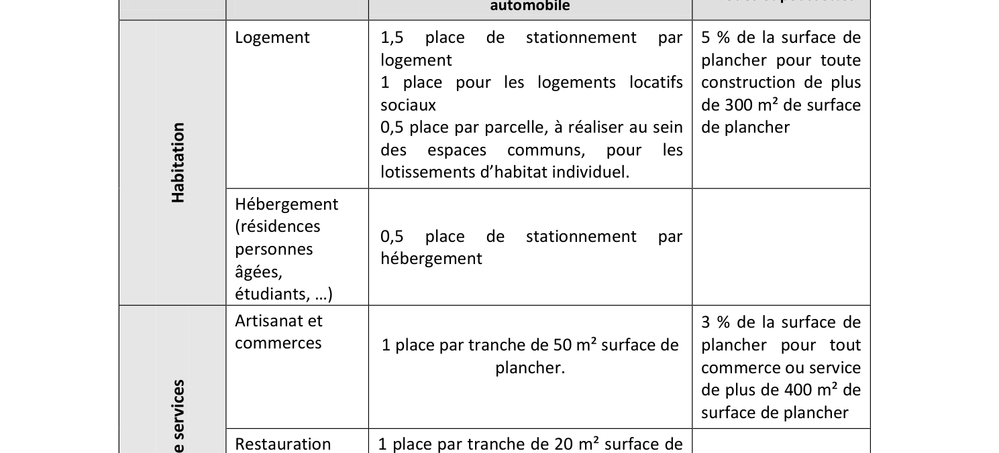

## 8. 97414 — zone UC2 (article UC 12.2 · p.52)
- **Valeur appliquée** : 2 place/logt (arr. superieur) · visiteur 0.5/1 logts
- **Condition(s) à vérifier** : les 0,5 place/logt au-delà de 10 logements sont des places PUBLIQUES (hors parcelle) — à vérifier
- **Citation** : « etc.). A titre indicatif, la superficie minimale d’une place de stationnement est de 25 m², y compris les
Habitations
Pour les logements sociaux
1 place de stationnement par logement
2 places de stationnement par logement
Pour les opérations de plus de 10 logements
1 place de stationnement pour deux chambres
1 place par tranche de 3 logements.
1 place visiteur par tranche de 5 logements.
1 place par tranche de 80 m² de service.
emplacement par logement,
pour les constructions à destination d’activités, un emplacement par tranche de 100 m² de surface
emplacements par tranche de 100 m² de surface de plancher pour les autres établissements, »
- **Preuve (image de la ligne, p.52) :**

  

## 9. 97424 — zone Ua (article Ua 12.2 · p.28)
- **Valeur appliquée** : 1.5 place/logt (arr. superieur)
- **Citation** : « 1. Pour les constructions à destination d’habitation : 1,5 place de stationnement par logement. »
- **Preuve (image de la ligne, p.28) :**

  

## 10. 97412 — zone U4 (article U4 12.2 · p.69)
- **Valeur appliquée** : 1 place/logt (arr. superieur) · visiteur 1/10 logts
- **Citation** : « d’habitation
(Logement ou hébergement)
- 1 place de stationnement minimum par logement.
- 1 place de stationnement minimum par logement locatifs
financés par un prêt aidé de l’État, et 0,5 place par logement si
- 1 place de stationnement minimum par tranche de 10
logements (1 logement étant équivalent à 3 places
âgées (RPA) 0,5 place de stationnement minimum par logement
visiteurs par tranche de 10 logements.
- 1 place de stationnement par seuil de 100 m² de surface de
- 1 place de stationnement minimum pour 2 chambres
- 1 place de stationnement minimum pour une capacité d’accueil
sept emplacements par tranche de 100 m² de surface de plancher pour les autres »
- **Preuve (image de la ligne, p.69) :**

  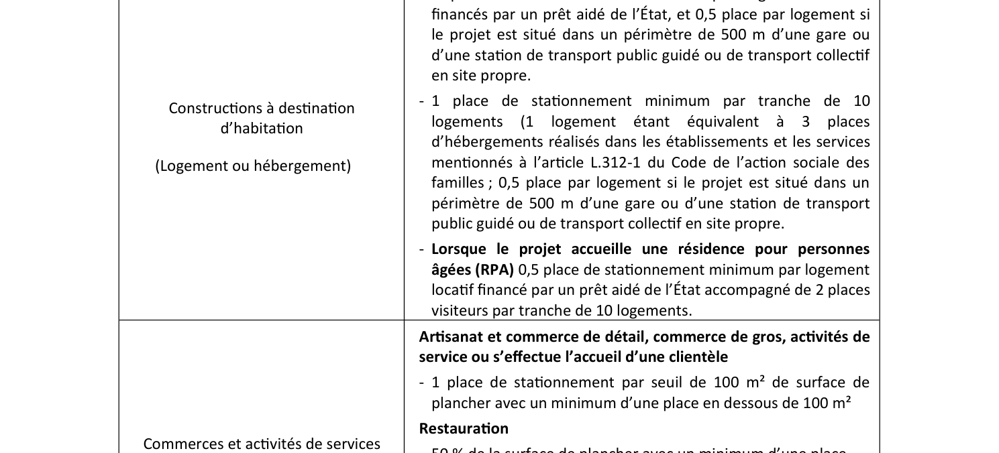

## 11. 97407 — zone 1AUa (article Ua 12.1 · p.151)
- **Valeur appliquée** : 0.3 place/logt (arr. superieur) · visiteur 1/100 m² · intégrées 100%>1000m²
- **Citation** : « Habitation
Logement
Il devra être réalisé au minimum :
-
0,3 place de stationnement par logement,
-
En outre, il est demandé 1 place de stationnement
pour visiteur par tranche de 100 m² de surface de
plancher.
100%
Logement locatif financé avec un prêt aidé de l’Etat
il devra être réalisé au minimum :
-
0,2 place / logement + 8 places / 1000 m² de surface
de plancher.
50% sauf pour les
maisons de ville et
les logements
individuels
Hébergement
Il devra être réalisé au minimum :
0,3 place de stationnement par chambre.
Néant
Equipements
d’intérêt
Il devra être réalisé au minimum :
Néant »
- **Preuve (image de la ligne, p.151) :**

  

## 12. 97401 — zone Uc1 (article U 12.2 · p.17)
- **Valeur appliquée** : typologie : individuel 1.5/logt ; collectif 1.25/logt [alt] ; collectif 1/35 m² [alt] ; social 1/logt
- **Condition(s) à vérifier** : 0,5 place supplémentaire sur voie par terrain pour les lotissements de plus de 5 lots
- **Citation** : « Dans le cas d’opération d’habitat collectif, la norme 1,5 est ramenée à 1,25 place par logement ou une
place par tranche de 35 m² de surface de plancher. La norme produisant le plus de places de
1 place de stationnement minimum pour trois chambres
1 place de stationnement minimum pour deux chambres
1 place de stationnement pour 10 m² de salle de restaurant
1 place de stationnement pour une capacité de 10 personnes.
emplacement minimum par logement,
pour les constructions à destination d’activités : un emplacement minimum par tranche de 100 m² de surface de plancher,
emplacements par classe pour les collèges ou lycée, sept emplacements par tranche de 100 m² de surface de plancher pour les autres »
- **Preuve (image de la ligne, p.17) :**

  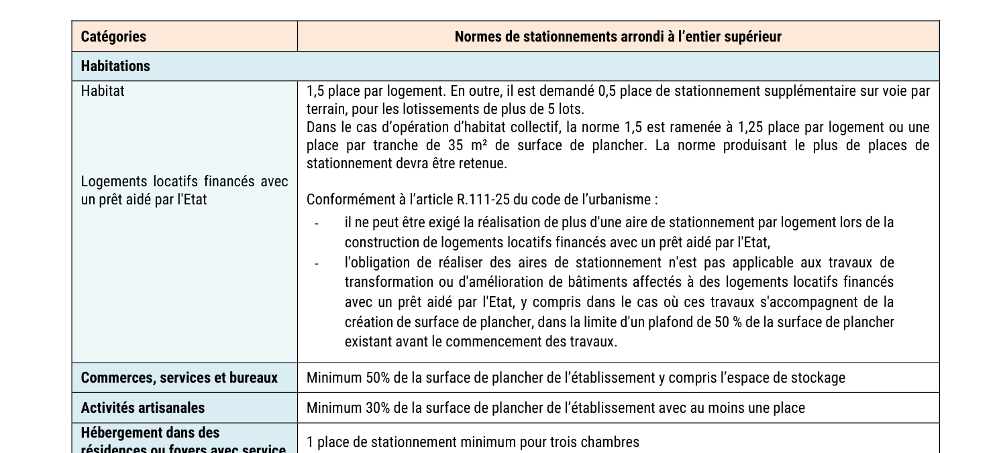

## 13. 97405 — zone UB (article UB.12 · p.31)
- **Valeur appliquée** : 1 place/logt (arr. superieur)
- **Condition(s) à vérifier** : toute opération de logements collectifs : 20 % de l'espace de stationnement aérien doit être perméable — à vérifier
- **Citation** : « pour les constructions à usage d’habitation : 1 place de stationnement par logement ;
b) pour les logements locatifs financés par un prêt aidé de l’Etat : 1 place de stationnement
par logement, à l’exception du Logement Locatif Très Social (LLTS) où aucune place de
stationnement n’est demandée ; pour toute opération de logements collectifs (financés ou non
financés par un prêt aidé de l’Etat), 20 % de l’espace dédié au stationnement aérien devront être
d) pour les hôtels et restaurants : 1 place de stationnement pour 2 chambres et 1 place de
0,75 m² par logement d’une ou deux pièces avec une superficie minimale de 3 m² ;
o  1,50 m² pour chaque logement de plus de deux pièces avec une superficie minimale »
- **Preuve (image de la ligne, p.31) :**

  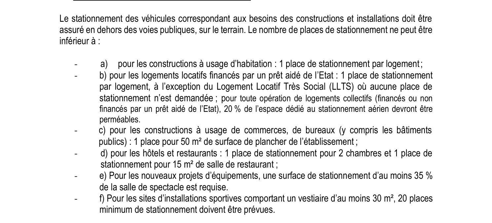

## 14. 97402 — zone Uba (article UB 12.2 · p.35)
- **Valeur appliquée** : typologie : collectif 1/logt ; collectif 1.5/logt ; social 1/logt ; senior 0.3333/logt ; etudiant 0.3333/logt
- **Citation** : « Autres logements
1 place maximum par logement aidé
1 place par logement d’une surface de plancher ≤ 100 m²
1,5 places par logement d’une surface de plancher ≥ 100 m²
1 place de stationnement pour 3 chambres
pour les constructions à destination d'habitation, l'espace possède une superficie de 0,75 m² par logement
pour les logements jusqu'à deux pièces principales et 1,5 m² par logement dans les autres cas, avec une »
- **Preuve (image de la ligne, p.35) :**

  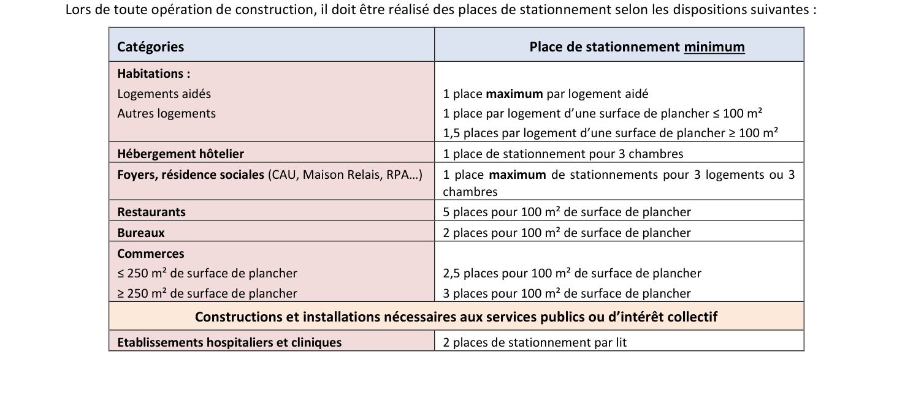

## 15. 97401 — zone Ua (article U 12.2 · p.17)
- **Valeur appliquée** : typologie : individuel 1.5/logt ; collectif 1.25/logt [alt] ; collectif 1/35 m² [alt] ; social 1/logt
- **Condition(s) à vérifier** : 0,5 place supplémentaire sur voie par terrain pour les lotissements de plus de 5 lots
- **Citation** : « Dans le cas d’opération d’habitat collectif, la norme 1,5 est ramenée à 1,25 place par logement ou une
place par tranche de 35 m² de surface de plancher. La norme produisant le plus de places de
1 place de stationnement minimum pour trois chambres
1 place de stationnement minimum pour deux chambres
1 place de stationnement pour 10 m² de salle de restaurant
1 place de stationnement pour une capacité de 10 personnes.
emplacement minimum par logement,
pour les constructions à destination d’activités : un emplacement minimum par tranche de 100 m² de surface de plancher,
emplacements par classe pour les collèges ou lycée, sept emplacements par tranche de 100 m² de surface de plancher pour les autres »
- **Preuve (image de la ligne, p.17) :**

  

## 16. 97401 — zone Ud1 (article U 12.2 · p.17)
- **Valeur appliquée** : typologie : individuel 1.5/logt ; collectif 1.25/logt [alt] ; collectif 1/35 m² [alt] ; social 1/logt
- **Condition(s) à vérifier** : 0,5 place supplémentaire sur voie par terrain pour les lotissements de plus de 5 lots
- **Citation** : « Dans le cas d’opération d’habitat collectif, la norme 1,5 est ramenée à 1,25 place par logement ou une
place par tranche de 35 m² de surface de plancher. La norme produisant le plus de places de
1 place de stationnement minimum pour trois chambres
1 place de stationnement minimum pour deux chambres
1 place de stationnement pour 10 m² de salle de restaurant
1 place de stationnement pour une capacité de 10 personnes.
emplacement minimum par logement,
pour les constructions à destination d’activités : un emplacement minimum par tranche de 100 m² de surface de plancher,
emplacements par classe pour les collèges ou lycée, sept emplacements par tranche de 100 m² de surface de plancher pour les autres »
- **Preuve (image de la ligne, p.17) :**

  

## 17. 97419 — zone Ub (article UB 12 · p.26)
- **Valeur appliquée** : typologie : collectif 1/logt ; collectif 1.5/logt ; social 1/logt
- **Citation** : « 1. Pour les constructions à destination d’habitation :
1 place de stationnement minimum par logement locatifs financés par un prêt aidé de l’État
1 place de stationnement minimum par logement d’une surface de plancher inférieure à 50m²
1,5 places de stationnement minimum par logement d’une surface de plancher supérieure ou égale à 50m², arrondi
4. Pour les constructions à destination d’hébergement hôtelier : 1 place de stationnement minimum pour deux chambres.
minimum par logement,
pour les constructions à destination de bureaux : un emplacement minimum par tranche de 100 m² de surface »
- **Preuve (image de la ligne, p.26) :**

  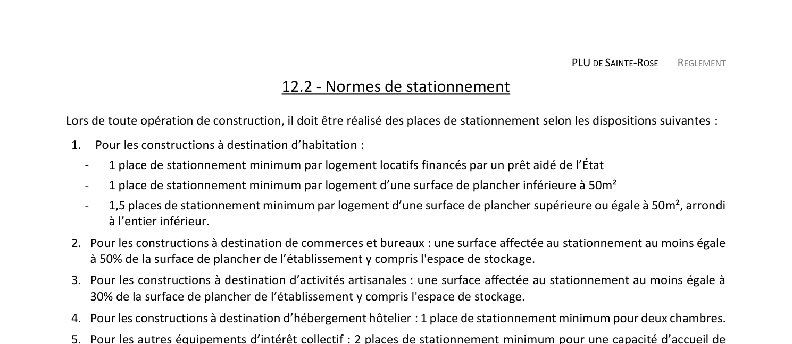

## 18. 97408 — zone UAm (article UA 12.2 · p.21)
- **Valeur appliquée** : typologie : collectif 1/logt ; collectif 2/logt ; social 1/logt ; senior 0.3333/logt ; etudiant 0.3333/logt · visiteur 1/5 logts
- **Citation** : « minimale d’une place de stationnement est de 25 m², y compris les dégagements (aire de manœuvre).
Autres logements ≤  à 50 m² de SDP
1 place minimum par logement
1 place visiteur pour 5 logements
Autres logements > à 50 m² de SDP
2 places minimum par logement
1 place de stationnement pour 3 places d’hébergement
2 places de stationnements minimum par tranche de 50 m² de surface de plancher
1 place de stationnement minimum par chambre
1 place de stationnement minimum par tranche de 50 m² de surface de plancher
1 place de stationnement minimum par tranche de 75 m² de surface de plancher y
1 place de stationnement minimum par classe
1 place de stationnement minimum par tranche de 50 m² de surface de plancher
1 place de stationnement minimum par tranche de 50 m² de surface de plancher
Autres logements ≤ à 50 m² de SDP
1 place minimum par logement
1 place visiteur pour 5 logements ou 5 lots
Autres logements > à 50 m² de SDP
2 places minimum par logement
1 place de stationnement pour 3 places d’hébergement
1 place par chambre
pour les constructions à destination d’habitation comportant au moins deux logements, un emplacement par logement,
pour les constructions à destination d’activités commerciales ou tertiaires, un emplacement par tranche de 100 m² de »
- **Preuve (image de la ligne, p.21) :**

  

## 19. 97418 — zone 1AUb (article U13 - 13.2 · p.26)
- **Valeur appliquée** : typologie : collectif 1/logt ; collectif 1.5/logt ; social 1/logt ; senior 0.3333/logt ; etudiant 0.3333/logt
- **Citation** : « Habitation
Logements locatifs financés avec un prêt aidé par
l'Etat
Conformément à l’article R.111-25 du code de l’urbanisme :
‐ il ne peut être exigé la réalisation de plus d'une aire de stationnement par logement lors
de la construction de logements locatifs financés avec un prêt aidé par l'Etat,
‐ l'obligation de réaliser des aires de stationnement n'est pas applicable aux travaux de
transformation ou d'amélioration de bâtiments affectés à des logements locatifs
financés avec un prêt aidé par l'Etat, y compris dans le cas où ces travaux
s'accompagnent de la création de surface de plancher, dans la limite d'un plafond de
50 % de la surface de plancher existant avant le commencement des travaux.
0,5 place par logement si situés à moins de 500 m d’une gare routière ou d'une station de
transport public guidé ou de transport collectif en site propre et que la qualité de la
desserte le permet
Logements privés d’une surface de plancher
inférieure à 100 m²
1 place minimum par logement
Logements privés d’une surface de plancher
supérieure ou égale à 100 m²
Opération d’un seul logement
2 places minimum
Opération de plusieurs logements
1,5 place minimum par logement
Logements privés situés à moins de 500 m d’une
gare routière ou d'une station de transport public
guidé ou de transport collectif en site propre et que
la qualité de la desserte le permet
1 place par logement
Hébergement
1 place de stationnement minimum pour trois chambres
Commerces et activités de services et bureaux
Commerces, activités de service, locaux, des
administrations publiques ou assimilés, bureaux et
activités artisanales
1 place de stationnement minimum pour 100 m² de surface de plancher y compris l'espace
de stockage »
- **Preuve (image de la ligne, p.26) :**

  

## 20. 97412 — zone U3 (article U3 12.2 · p.55)
- **Valeur appliquée** : 2 place/logt (arr. superieur) · visiteur 1/10 logts
- **Citation** : « talus, etc.). A titre indicatif, la superficie minimale d’une place de stationnement est de 25 m², y compris les
d’habitation
(Logement ou hébergement)
- 2 places de stationnement minimum par logement.
- 1 place de stationnement minimum par logement locatifs
financés par un prêt aidé de l’État, et 0,5 place par logement si
- 1 place de stationnement minimum par tranche de 10
logements (1 logement étant équivalent à 3 places
âgées (RPA) 0,5 place de stationnement minimum par logement
locatif financé par un prêt aidé de l’État accompagné de 2 places
visiteurs par tranche de 10 logements.
- 1 place de stationnement par seuil de 100 m² de surface de
- 1 place de stationnement minimum pour 2 chambres
- 1 place de stationnement minimum pour une capacité d’accueil
sept emplacements par tranche de 100 m² de surface de plancher pour les autres »
- **Preuve (image de la ligne, p.55) :**

  
