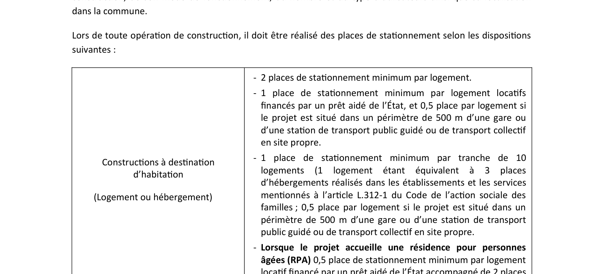
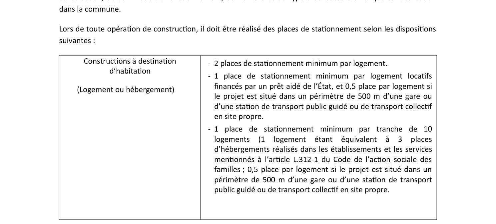
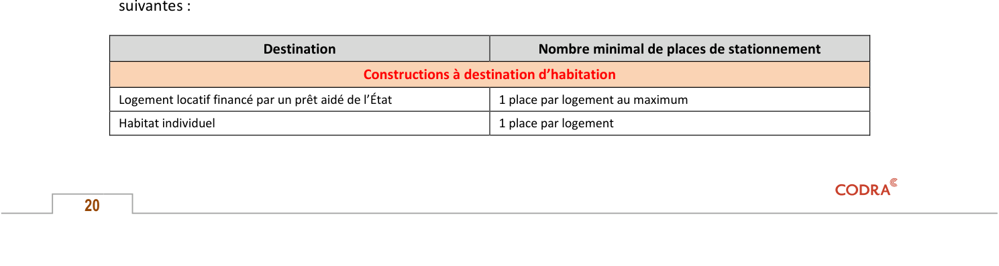
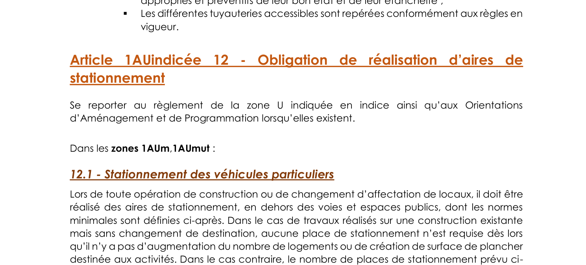
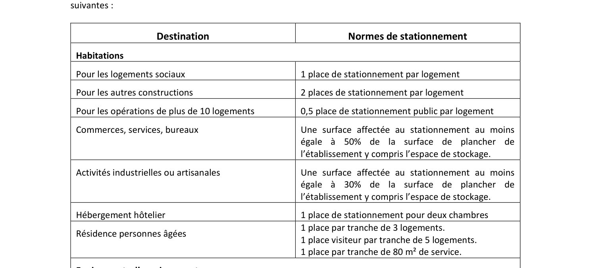
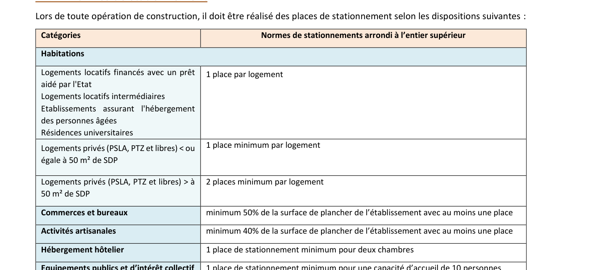
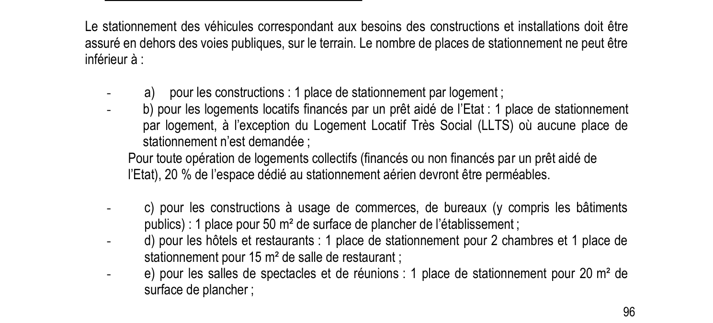
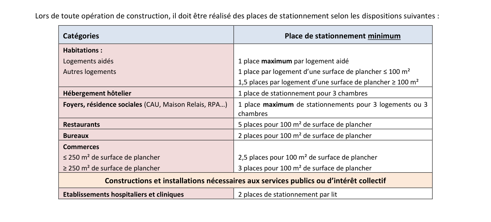
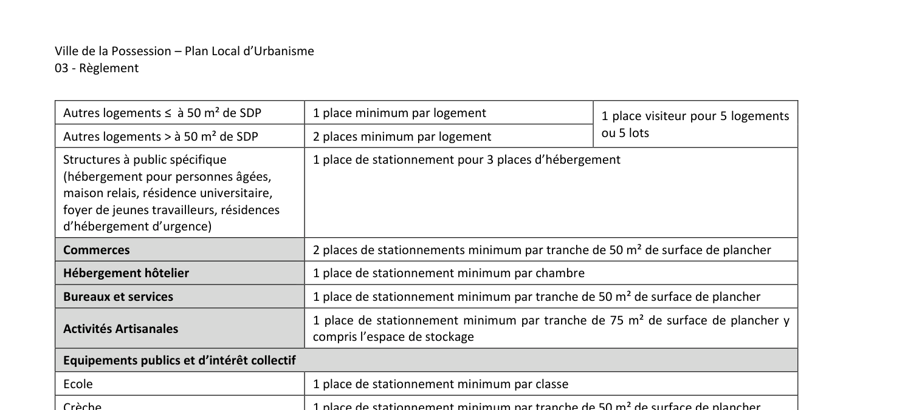

# SONDAGE-10-LOT3 — dix règles tirées à GRAINE FIXE, prouvées par la page

ETUDE-STATIONNEMENT-FIX-1 (LOT 3). Tirage **déterministe** (non choisi) sur les 163 zones constructibles servies des communes à texte en base.

**Commande du tirage :**
```
PYTHONPATH=src python scripts/sondage_tirage.py --seed 20260115 --n 10
PYTHONPATH=src python scripts/sondage_images.py --seed 20260115 --n 10
```

Chaque règle : la valeur appliquée, la citation, l'article · page, et l'**image de la ligne entière** du PDF officiel.

## 1. 97412 — zone 1AU3 (article U3 12.2 · p.55)
- **Valeur appliquée** : 2 place/logt (arr. superieur) · visiteur 1/10 logts
- **Citation** : « 2 place(s) de stationnement minimum par logement. 1 place par tranche de 10 logements (part collective). Logement prêt aidé : 1/logt (0,5 si < 500 m d'un transport collectif). Résidence pour personnes âgées : 0,5 place/logt aidé + 2 places visiteurs par tranche de 10 logements. »
- **Preuve (image de la ligne, p.55) :**

  

## 2. 97412 — zone U5vi (article U5 12.2 · p.84)
- **Valeur appliquée** : 2 place/logt (arr. superieur) · visiteur 1/10 logts
- **Citation** : « 2 place(s) de stationnement minimum par logement. 1 place par tranche de 10 logements (part collective). Logement prêt aidé : 1/logt (0,5 si < 500 m d'un transport collectif). Résidence pour personnes âgées : 0,5 place/logt aidé + 2 places visiteurs par tranche de 10 logements. »
- **Preuve (image de la ligne, p.84) :**

  

## 3. 97422 — zone 1AUa (article Ua12.2 · p.22)
- **Valeur appliquée** : typologie : collectif 0.5/logt ; collectif 1/logt ; collectif 1.5/logt ; individuel 1/logt ; collectif 1.5/logt [operation] ; social 1/logt ; senior 0.3333/logt ; etudiant 0.3333/logt
- **Condition(s) à vérifier** : dont au moins 0,5 place à l'extérieur des espaces privatisés (opération/lotissement de plus de 5 logements/lots)
- **Citation** : « Habitat individuel : 1 place par logement. Habitat collectif (autre que logements sociaux) : 0,5 place par chambre et studio ; 1 place par logement de 2 pièces ; 1,5 place par logement de 3 pièces et plus. Lotissement ou opération supérieur à 5 lots ou logements : 1,5 place par logement, arrondi à l'entier inférieur dont au moins 0,5 place à l'extérieur des espaces privatisés. Logement locatif financé par un prêt aidé de l'État : 1 place par logement au maximum. Foyer, résidence sociale (FPA, EHPAD, etc.) : 1 place pour 3 chambres ou logement. »
- **Preuve (image de la ligne, p.22) :**

  

## 4. 97407 — zone 1AUm (article 1AU 12.1 · p.151)
- **Valeur appliquée** : 0.3 place/logt (arr. superieur) · visiteur 1/100 m² · intégrées 100%>1000m²
- **Citation** : « 0,3 place de stationnement par logement. En outre, 1 place de stationnement pour visiteur par tranche de 100 m² de surface de plancher. Logement locatif financé avec un prêt aidé de l'État : 0,2 place par logement, plus 8 places par tranche de 1000 m² de surface de plancher. »
- **Preuve (image de la ligne, p.151) :**

  

## 5. 97414 — zone UD (article UD 12.2 · p.66)
- **Valeur appliquée** : 2 place/logt (arr. superieur)
- **Condition(s) à vérifier** : opérations de plus de 10 logements : 0,5 place de stationnement PUBLIC par logement (hors parcelle) — à vérifier
- **Citation** : « Logements sociaux : 1 place par logement. Autres constructions : 2 places par logement. Opérations de plus de 10 logements : 0,5 place de stationnement public par logement. Résidence pour personnes âgées : 1 place par tranche de 3 logements + 1 place visiteur par tranche de 5 logements. »
- **Preuve (image de la ligne, p.66) :**

  

## 6. 97421 — zone UB (article U 12.2 · p.18)
- **Valeur appliquée** : typologie : collectif 1/logt ; collectif 2/logt ; social 1/logt ; senior 1/logt ; etudiant 1/logt
- **Citation** : « Logements prêt aidé / intermédiaires / hébergement personnes âgées / résidences universitaires : 1 place par logement. Logements privés (PSLA, PTZ, libres) ≤ 50 m² de SDP : 1 place min/logt. Logements privés > 50 m² de SDP : 2 places min/logt. Arrondi à l'entier supérieur (en-tête). »
- **Preuve (image de la ligne, p.18) :**

  

## 7. 97405 — zone 1AU (article 1AU.12 · p.96)
- **Valeur appliquée** : 1 place/logt (arr. superieur)
- **Condition(s) à vérifier** : toute opération de logements collectifs : 20 % de l'espace de stationnement aérien doit être perméable — à vérifier
- **Citation** : « Pour les constructions à usage d'habitation : 1 place de stationnement par logement. Logement Locatif Très Social (LLTS) : aucune place de stationnement demandée. Toute opération de logements collectifs : 20 % de l'espace de stationnement aérien doit être perméable. »
- **Preuve (image de la ligne, p.96) :**

  

## 8. 97402 — zone Ub (article UB 12.2 · p.35)
- **Valeur appliquée** : typologie : collectif 1/logt ; collectif 1.5/logt ; social 1/logt ; senior 0.3333/logt ; etudiant 0.3333/logt
- **Citation** : « Logements aidés : 1 place maximum par logement aidé. Autres logements : 1 place par logement d'une surface de plancher ≤ 100 m² ; 1,5 place par logement d'une surface de plancher ≥ 100 m². Foyers, résidences sociales : 1 place pour 3 logements ou chambres. »
- **Preuve (image de la ligne, p.35) :**

  

## 9. 97412 — zone U4 (article U4 12.2 · p.69)
- **Valeur appliquée** : 1 place/logt (arr. superieur) · visiteur 1/10 logts
- **Citation** : « 1 place(s) de stationnement minimum par logement. 1 place par tranche de 10 logements (part collective). Logement prêt aidé : 1/logt (0,5 si < 500 m d'un transport collectif). Résidence pour personnes âgées : 0,5 place/logt aidé + 2 places visiteurs par tranche de 10 logements. »
- **Preuve (image de la ligne, p.69) :**

  

## 10. 97408 — zone UApsfr2 (article UA 12.2 · p.21)
- **Valeur appliquée** : typologie : collectif 1/logt ; collectif 2/logt ; social 1/logt ; senior 0.3333/logt ; etudiant 0.3333/logt · visiteur 1/5 logts
- **Citation** : « Logements prêt aidé (LLTS/LLS/PLS) : 1 place/logt (0,5 si < 500 m d'un transport collectif). Autres logements ≤ 50 m² de SDP : 1 place min + 1 place visiteur pour 5 logements/lots. Autres logements > 50 m² de SDP : 2 places min. Structures à public spécifique (personnes âgées, résidence universitaire, foyer…) : 1 place pour 3 places d'hébergement. »
- **Preuve (image de la ligne, p.21) :**

  
