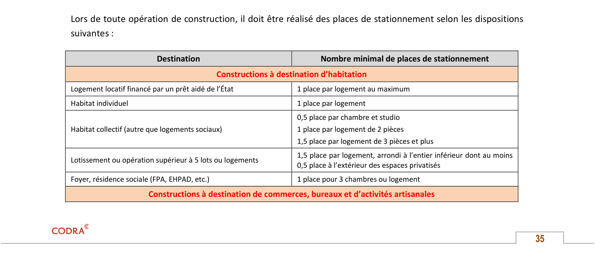
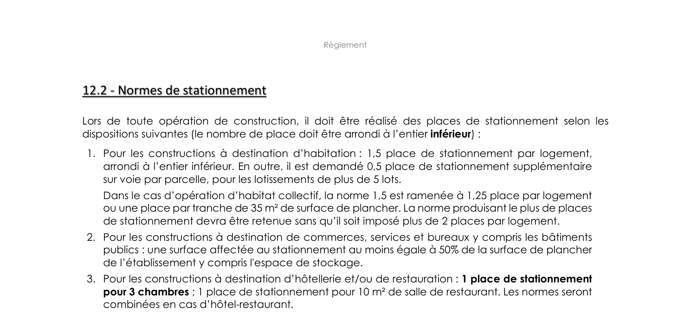
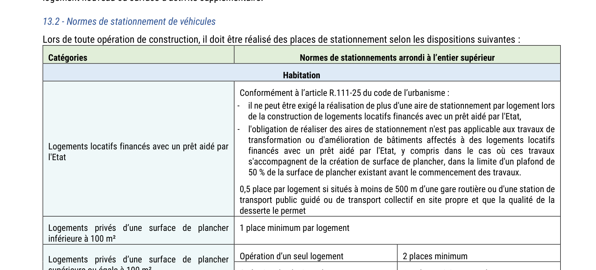
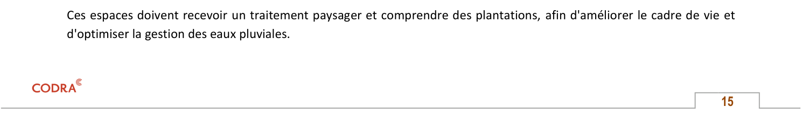
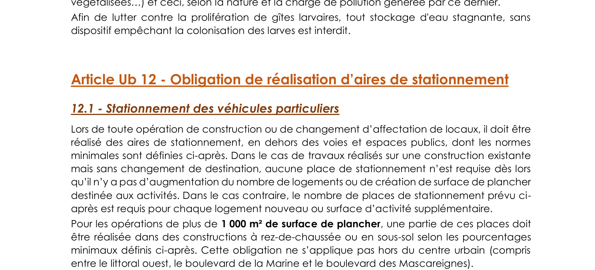
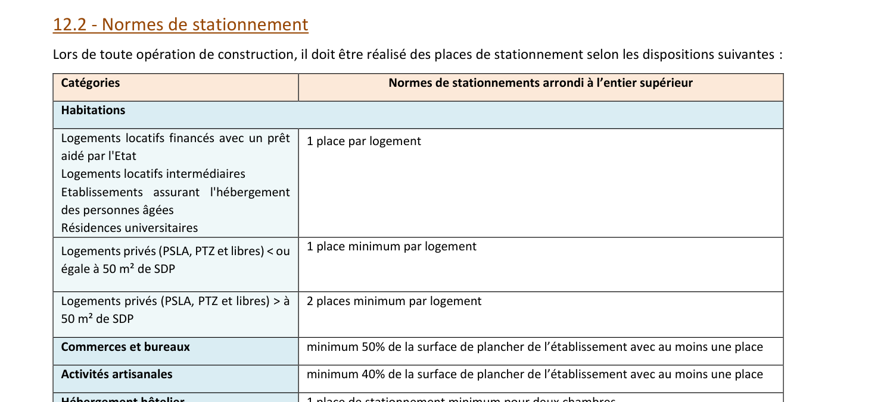

# SONDAGE-10-LOT3 — dix règles tirées à GRAINE FIXE, prouvées par la page

ETUDE-STATIONNEMENT-FIX-1 (LOT 3). Tirage **déterministe** (non choisi) sur les 163 zones constructibles servies des communes à texte en base.

**Commande du tirage :**
```
PYTHONPATH=src python scripts/sondage_tirage.py --seed 20260117 --n 10
PYTHONPATH=src python scripts/sondage_images.py --seed 20260117 --n 10
```

Chaque règle : la valeur appliquée, la citation, l'article · page, et l'**image de la ligne entière** du PDF officiel.

## 1. 97421 — zone UA1 (article U 12.2 · p.18)
- **Valeur appliquée** : typologie : collectif 1/logt ; collectif 2/logt ; social 1/logt ; senior 1/logt ; etudiant 1/logt
- **Citation** : « Habitations
Logements locatifs financés avec un prêt
aidé par l'Etat
Logements locatifs intermédiaires
Etablissements assurant l'hébergement
des personnes âgées
Résidences universitaires
1 place par logement
Logements privés (PSLA, PTZ et libres) < ou
égale à 50 m² de SDP
1 place minimum par logement
Logements privés (PSLA, PTZ et libres) > à
50 m² de SDP
2 places minimum par logement
Commerces et bureaux »
- **Preuve (image de la ligne, p.18) :**

  

## 2. 97422 — zone 1AUb (article Ub12.2 · p.37)
- **Valeur appliquée** : typologie : collectif 0.5/logt ; collectif 1/logt ; collectif 1.5/logt ; individuel 1/logt ; collectif 1.5/logt [operation] ; social 1/logt ; senior 0.3333/logt ; etudiant 0.3333/logt
- **Condition(s) à vérifier** : dont au moins 0,5 place à l'extérieur des espaces privatisés (opération/lotissement de plus de 5 logements/lots)
- **Citation** : « Constructions à destination d’habitation
Logement locatif financé par un prêt aidé de l’État
1 place par logement au maximum
Habitat individuel
1 place par logement
Habitat collectif (autre que logements sociaux)
1 place par logement de 2 pièces
1,5 place par logement de 3 pièces et plus
Lotissement ou opération supérieur à 5 lots ou logements
1,5 place par logement, arrondi à l’entier inférieur dont au moins
1 place pour 3 chambres ou logement
1 place pour deux chambres
pour les constructions à destination d'habitation, l'espace possède une superficie de 0,75 m² par
logement pour les logements jusqu'à deux pièces principales et 1,5 m² par logement dans les »
- **Preuve (image de la ligne, p.37) :**

  

## 3. 97419 — zone 1AUa (article AUINDICEE 12 (renvoi UA 12) · p.17)
- **Valeur appliquée** : typologie : collectif 1/logt ; collectif 1.5/logt ; social 1/logt
- **Citation** : « 1. Pour les constructions à destination d’habitation :
1 place de stationnement minimum par logement locatifs financés par un prêt aidé de l’État
1 place de stationnement minimum par logement d’une surface de plancher inférieure à 50m²
1,5 places de stationnement minimum par logement d’une surface de plancher supérieure ou égale à 50m², arrondi
4. Pour les constructions à destination d’hébergement hôtelier : 1 place de stationnement minimum pour deux chambres.
minimum par logement,
pour les constructions à destination de bureaux : un emplacement minimum par tranche de 100 m² de surface »
- **Preuve (image de la ligne, p.17) :**

  

## 4. 97423 — zone Ua (article Ua 12.2 · p.22)
- **Valeur appliquée** : typologie : individuel 1.5/logt ; collectif 1.25/logt [alt] ; collectif 1/35 m² [alt]
- **Condition(s) à vérifier** : 0,5 place supplémentaire sur voie/parcelle pour les lotissements de plus de 5 lots ; collectif : la norme retenue est plafonnée à 2 places par logement — à vérifier si la plus exigeante la dépasse
- **Citation** : « 1. Pour les constructions à destination d’habitation : 1,5 place de stationnement par logement,
Dans le cas d’opération d’habitat collectif, la norme 1,5 est ramenée à 1,25 place par logement
ou une place par tranche de 35 m² de surface de plancher. La norme produisant le plus de places
de stationnement devra être retenue sans qu’il soit imposé plus de 2 places par logement. »
- **Preuve (image de la ligne, p.22) :**

  

## 5. 97421 — zone UB (article U 12.2 · p.18)
- **Valeur appliquée** : typologie : collectif 1/logt ; collectif 2/logt ; social 1/logt ; senior 1/logt ; etudiant 1/logt
- **Citation** : « Habitations
Logements locatifs financés avec un prêt
aidé par l'Etat
Logements locatifs intermédiaires
Etablissements assurant l'hébergement
des personnes âgées
Résidences universitaires
1 place par logement
Logements privés (PSLA, PTZ et libres) < ou
égale à 50 m² de SDP
1 place minimum par logement
Logements privés (PSLA, PTZ et libres) > à
50 m² de SDP
2 places minimum par logement
Commerces et bureaux »
- **Preuve (image de la ligne, p.18) :**

  

## 6. 97418 — zone UAb (article U13 - 13.2 · p.26)
- **Valeur appliquée** : typologie : collectif 1/logt ; collectif 1.5/logt ; social 1/logt ; senior 0.3333/logt ; etudiant 0.3333/logt
- **Citation** : « Habitation
Logements locatifs financés avec un prêt aidé par
l'Etat
Conformément à l’article R.111-25 du code de l’urbanisme :
‐ il ne peut être exigé la réalisation de plus d'une aire de stationnement par logement lors
de la construction de logements locatifs financés avec un prêt aidé par l'Etat,
‐ l'obligation de réaliser des aires de stationnement n'est pas applicable aux travaux de
transformation ou d'amélioration de bâtiments affectés à des logements locatifs
financés avec un prêt aidé par l'Etat, y compris dans le cas où ces travaux
s'accompagnent de la création de surface de plancher, dans la limite d'un plafond de
50 % de la surface de plancher existant avant le commencement des travaux.
0,5 place par logement si situés à moins de 500 m d’une gare routière ou d'une station de
transport public guidé ou de transport collectif en site propre et que la qualité de la
desserte le permet
Logements privés d’une surface de plancher
inférieure à 100 m²
1 place minimum par logement
Logements privés d’une surface de plancher
supérieure ou égale à 100 m²
Opération d’un seul logement
2 places minimum
Opération de plusieurs logements
1,5 place minimum par logement
Logements privés situés à moins de 500 m d’une
gare routière ou d'une station de transport public
guidé ou de transport collectif en site propre et que
la qualité de la desserte le permet
1 place par logement
Hébergement
1 place de stationnement minimum pour trois chambres
Commerces et activités de services et bureaux
Commerces, activités de service, locaux, des
administrations publiques ou assimilés, bureaux et
activités artisanales
1 place de stationnement minimum pour 100 m² de surface de plancher y compris l'espace
de stockage »
- **Preuve (image de la ligne, p.26) :**

  

## 7. 97419 — zone Ua (article UA 12 · p.17)
- **Valeur appliquée** : typologie : collectif 1/logt ; collectif 1.5/logt ; social 1/logt
- **Citation** : « 1. Pour les constructions à destination d’habitation :
1 place de stationnement minimum par logement locatifs financés par un prêt aidé de l’État
1 place de stationnement minimum par logement d’une surface de plancher inférieure à 50m²
1,5 places de stationnement minimum par logement d’une surface de plancher supérieure ou égale à 50m², arrondi
4. Pour les constructions à destination d’hébergement hôtelier : 1 place de stationnement minimum pour deux chambres.
minimum par logement,
pour les constructions à destination de bureaux : un emplacement minimum par tranche de 100 m² de surface »
- **Preuve (image de la ligne, p.17) :**

  

## 8. 97407 — zone Ub (article Ub 12.1 · p.44)
- **Valeur appliquée** : 0.3 place/logt (arr. superieur) · visiteur 1/100 m² · intégrées 100%>1000m²
- **Citation** : « Habitation
Logement
Il devra être réalisé au minimum :
-
0,3 place de stationnement par logement,
-
En outre, il est demandé 1 place de stationnement
pour visiteur par tranche de 100 m² de surface de
plancher.
100%
Logement locatif financé avec un prêt aidé de l’Etat
il devra être réalisé au minimum :
-
0,2 place / logement + 8 places / 1000 m² de surface
de plancher
50% sauf pour les
maisons de ville et
les logements
individuels
Hébergement
Il devra être réalisé au minimum :
0,3 place de stationnement par chambre.
Néant
Equipements
d’intérêt
collectif et
services
publics
Il devra être réalisé au minimum :
-
1 place de stationnement par tranche de 50 m² de
surface de plancher.
En outre, le nombre de places à réaliser doit répondre aux »
- **Preuve (image de la ligne, p.44) :**

  

## 9. 97421 — zone AUb (article U 12.2 · p.18)
- **Valeur appliquée** : typologie : collectif 1/logt ; collectif 2/logt ; social 1/logt ; senior 1/logt ; etudiant 1/logt
- **Citation** : « Habitations
Logements locatifs financés avec un prêt
aidé par l'Etat
Logements locatifs intermédiaires
Etablissements assurant l'hébergement
des personnes âgées
Résidences universitaires
1 place par logement
Logements privés (PSLA, PTZ et libres) < ou
égale à 50 m² de SDP
1 place minimum par logement
Logements privés (PSLA, PTZ et libres) > à
50 m² de SDP
2 places minimum par logement
Commerces et bureaux »
- **Preuve (image de la ligne, p.18) :**

  

## 10. 97412 — zone U3ar (article U3 12.2 · p.55)
- **Valeur appliquée** : 2 place/logt (arr. superieur) · visiteur 1/10 logts
- **Citation** : « talus, etc.). A titre indicatif, la superficie minimale d’une place de stationnement est de 25 m², y compris les
d’habitation
(Logement ou hébergement)
- 2 places de stationnement minimum par logement.
- 1 place de stationnement minimum par logement locatifs
financés par un prêt aidé de l’État, et 0,5 place par logement si
- 1 place de stationnement minimum par tranche de 10
logements (1 logement étant équivalent à 3 places
âgées (RPA) 0,5 place de stationnement minimum par logement
locatif financé par un prêt aidé de l’État accompagné de 2 places
visiteurs par tranche de 10 logements.
- 1 place de stationnement par seuil de 100 m² de surface de
- 1 place de stationnement minimum pour 2 chambres
- 1 place de stationnement minimum pour une capacité d’accueil
sept emplacements par tranche de 100 m² de surface de plancher pour les autres »
- **Preuve (image de la ligne, p.55) :**

  
