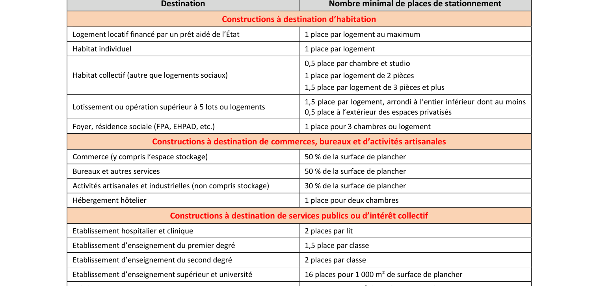
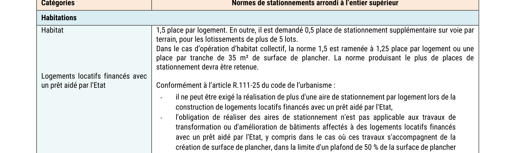
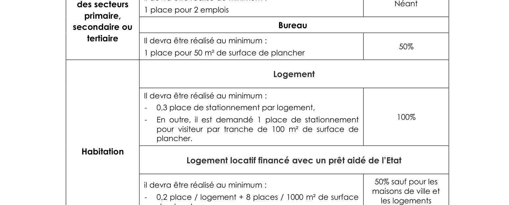
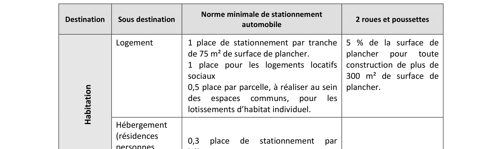
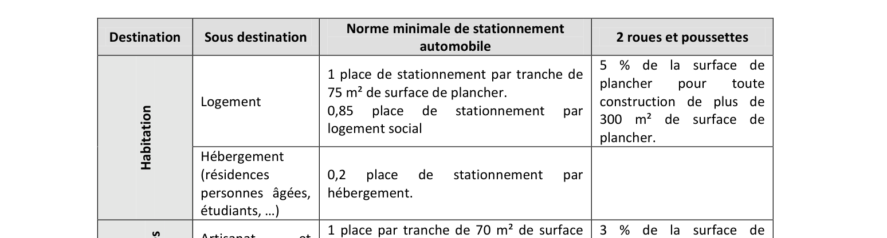
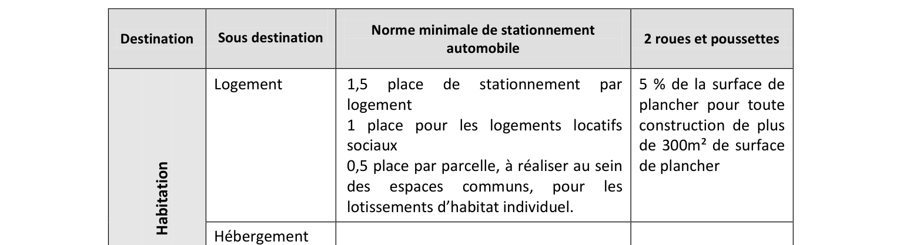
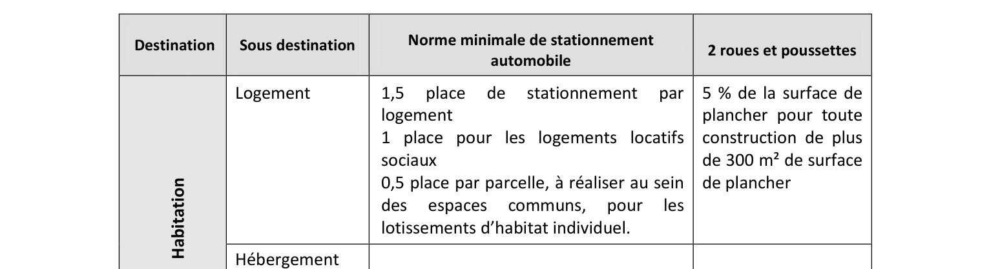
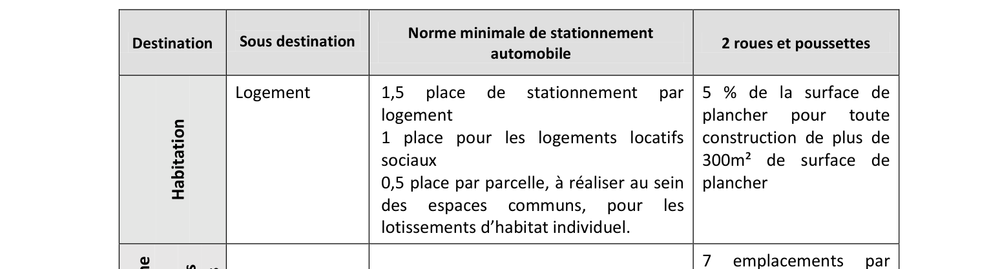
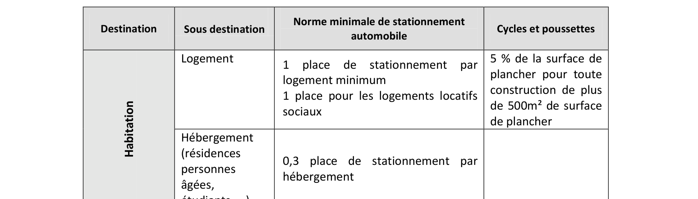

# SONDAGE-10 — dix règles DISTINCTES de stationnement, prouvées par la page

ETUDE-STATIONNEMENT-FIX-1 (correctif). Dix règles distinctes (pas deux zones au même texte), tirées dans les cinq communes pilotes. Chacune : la **valeur appliquée par LABUSE**, la **citation propre à la zone**, l'**article · page**, le **sens d'arrondi avec la phrase qui le fonde**, et une **image recadrée du tableau de la page officielle** (PDF opposable servi par le GPU) qui porte chaque chiffre appliqué.

> Rien n'est pris d'un extrait de base lossy : la preuve est l'image du tableau. Toute valeur qu'aucune page ne prouverait serait repassée en « propose » (contrôle « Non vérifié »).

## 1. Le Tampon — zone Ud (habitat collectif + opération > 5)
- **INSEE / zone** : 97422 / Ud — **article Ud12.2 · p.67**
- **Valeur appliquée** : mode **par_typologie** · collectif 0.5/logt · collectif 1/logt · collectif 1.5/logt · individuel 1/logt · collectif 1.5/logt [operation] · social 1/logt
- **Condition(s) à vérifier (non comptées)** : dont au moins 0,5 place à l'extérieur des espaces privatisés (opération/lotissement de plus de 5 logements/lots)
- **Arrondi** : opération > 5 : « arrondi à l'entier **inférieur** » (texte explicite, cf. image) ; retenue = la plus exigeante entre collectif-par-pièces et opération > 5.
- **Citation (texte propre à la zone)** : « Habitat individuel : 1 place par logement. Habitat collectif (autre que logements sociaux) : 0,5 place par chambre et studio ; 1 place par logement de 2 pièces ; 1,5 place par logement de 3 pièces et plus. Lotissement ou opération supérieur à 5 lots ou logements : 1,5 place par logement, arrondi à l'entier inférieur dont au moins 0,5 place à l'extérieur des espaces privatisés. Logement locatif financé par un prêt aidé de l'État : 1 place par logement au maximum. Foyer, résidence sociale (FPA, EHPAD, etc.) : 1 place pour 3 chambres ou logement. »
- **Preuve (image du tableau, p.67) :**
  

## 2. Les Avirons — zone Ua (max de deux formules)
- **INSEE / zone** : 97401 / Ua — **article U 12.2 · p.17**
- **Valeur appliquée** : mode **par_typologie** · individuel 1.5/logt · collectif 1.25/logt [alt] · collectif 1 place/35 m² [alt] · social 1/logt
- **Condition(s) à vérifier (non comptées)** : 0,5 place supplémentaire sur voie par terrain pour les lotissements de plus de 5 lots
- **Arrondi** : « 1 place par tranche de 35 m² » : texte **muet** sur l'arrondi → plus exigeant = **supérieur** (dit).
- **Citation (texte propre à la zone)** : « 1,5 place par logement. En outre, 0,5 place de stationnement supplémentaire sur voie par terrain, pour les lotissements de plus de 5 lots. Dans le cas d'opération d'habitat collectif, la norme 1,5 est ramenée à 1,25 place par logement ou une place par tranche de 35 m² de surface de plancher. La norme produisant le plus de places de stationnement devra être retenue. »
- **Preuve (image du tableau, p.17) :**
  

## 3. Saint-Benoît — zone Ua (visiteur > 5 + aidé)
- **INSEE / zone** : 97410 / Ua — **article U 12 · p.17**
- **Valeur appliquée** : mode **par_logement** · 1 place/logt (arrondi superieur) · visiteur 1/5 logts (>5 logts) arrondi superieur
- **Arrondi** : visiteur « 1 par tranche de 5 logements » : texte muet → plus exigeant = **supérieur** (⌈n/5⌉) ; appliqué seulement au-delà de 5 logements.
- **Citation (texte propre à la zone)** : « Logements individuels, construction ou opération de 5 logements ou moins : 1 place par logement. Lotissements ou opérations de plus de 5 logements : 1 place par logement, plus une place visiteur par tranche de 5 lots ou 5 logements. Logements aidés : 1 place pour 2 logements. Résidences universitaires et de personnes âgées : 1 place pour 3 logements ou 3 chambres. »
- **Preuve (image du tableau, p.17) :**
  

## 4. Le Port — zone Ua (0,3/logt + visiteur/100 m²)
- **INSEE / zone** : 97407 / Ua — **article Ua 12.1 · p.30**
- **Valeur appliquée** : mode **par_logement** · 0.3 place/logt (arrondi superieur) · visiteur 1/100 m² arrondi superieur
- **Arrondi** : destination **Habitation / Logement** (les lignes « 1 place / 60 m² » de l'image voisine relèvent du commerce/service, pas de l'habitation) ; visiteur « 1 / 100 m² » muet → supérieur.
- **Citation (texte propre à la zone)** : « 0,3 place de stationnement par logement. En outre, 1 place de stationnement pour visiteur par tranche de 100 m² de surface de plancher. Logement locatif financé avec un prêt aidé de l'État : 0,2 place par logement, plus 8 places par tranche de 1000 m² de surface de plancher. »
- **Preuve (image du tableau, p.30) :**
  

## 5. Saint-Pierre — zone Ud (1 place / 75 m², social 1)
- **INSEE / zone** : 97416 / Ud — **article Ud6 · p.93**
- **Valeur appliquée** : mode **par_m2_sdp** · 1 place / 75 m² de SDP (**arrondi inferieur**)
- **Condition(s) à vérifier (non comptées)** : 0,5 place par parcelle pour les lotissements d'habitat individuel (espaces communs)
- **Arrondi** : « la place est comptabilisée par **tranche complète** » → seules les tranches entières comptent → **arrondi inférieur** (888 m² → 11, pas 12).
- **Citation (texte propre à la zone)** : « Habitation / Logement : 1 place de stationnement par tranche de 75 m² de surface de plancher. 1 place pour les logements locatifs sociaux. 0,5 place par parcelle, à réaliser au sein des espaces communs, pour les lotissements d'habitat individuel. La place de stationnement est comptabilisée par tranche complète (arrondi inférieur). »
- **Preuve (image du tableau, p.93) :**
  

## 6. Saint-Pierre — zone Ucv (1 place / 75 m², social 0,85)
- **INSEE / zone** : 97416 / Ucv — **article Ucv6 · p.72**
- **Valeur appliquée** : mode **par_m2_sdp** · 1 place / 75 m² de SDP (**arrondi inferieur**)
- **Arrondi** : idem tranche complète → arrondi inférieur ; social **0,85 place/logement social** (propre à Ucv, ≠ Ud).
- **Citation (texte propre à la zone)** : « Habitation / Logement : 1 place de stationnement par tranche de 75 m² de surface de plancher. 0,85 place de stationnement par logement social. La place de stationnement est comptabilisée par tranche complète (arrondi inférieur). »
- **Preuve (image du tableau, p.72) :**
  

## 7. Saint-Pierre — zone Uf (1,5/logt + social)
- **INSEE / zone** : 97416 / Uf — **article Uf6 · p.127**
- **Valeur appliquée** : mode **par_logement** · 1.5 place/logt (arrondi superieur)
- **Condition(s) à vérifier (non comptées)** : 0,5 place par parcelle pour les lotissements d'habitat individuel (espaces communs)
- **Arrondi** : 1,5 place par logement (pas de tranche).
- **Citation (texte propre à la zone)** : « Habitation / Logement : 1,5 place de stationnement par logement. 1 place pour les logements locatifs sociaux. 0,5 place par parcelle, à réaliser au sein des espaces communs, pour les lotissements d'habitat individuel. »
- **Preuve (image du tableau, p.127) :**
  

## 8. Saint-Pierre — zone Ug (1,5/logt + social)
- **INSEE / zone** : 97416 / Ug — **article Ug6 · p.110**
- **Valeur appliquée** : mode **par_logement** · 1.5 place/logt (arrondi superieur)
- **Condition(s) à vérifier (non comptées)** : 0,5 place par parcelle pour les lotissements d'habitat individuel (espaces communs)
- **Arrondi** : 1,5 place par logement (pas de tranche).
- **Citation (texte propre à la zone)** : « Habitation / Logement : 1,5 place de stationnement par logement. 1 place pour les logements locatifs sociaux. 0,5 place par parcelle, à réaliser au sein des espaces communs, pour les lotissements d'habitat individuel. »
- **Preuve (image du tableau, p.110) :**
  

## 9. Saint-Pierre — zone Us (1,5/logt + social)
- **INSEE / zone** : 97416 / Us — **article None · p.None**
- **Valeur appliquée** : mode **absent**
- **Arrondi** : 1,5 place par logement (pas de tranche).
- **Citation (texte propre à la zone)** : « None »
- **Preuve (image du tableau, p.None) :**
  

## 10. Saint-Pierre — zone Up (1/logt minimum + social)
- **INSEE / zone** : 97416 / Up — **article Up6 · p.153**
- **Valeur appliquée** : mode **par_logement** · 1 place/logt (arrondi superieur)
- **Arrondi** : 1 place par logement minimum (pas de tranche).
- **Citation (texte propre à la zone)** : « Habitation / Logement : 1 place de stationnement par logement minimum. 1 place pour les logements locatifs sociaux. »
- **Preuve (image du tableau, p.153) :**
  
