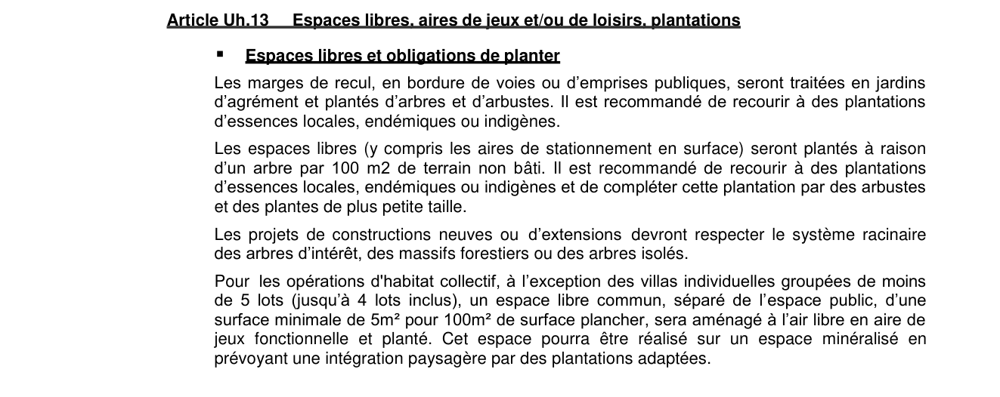
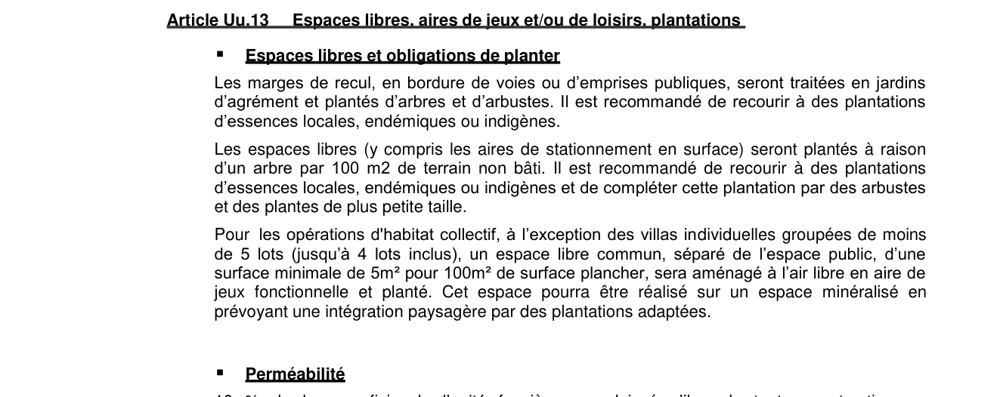
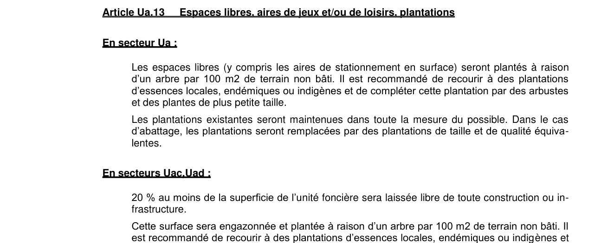

# Saint-Denis — pleine terre dans le règlement EN VIGUEUR (97411_PLU_20260805)

Vérification zone par zone, image de la ligne/section de l'article 13 à l'appui. Les valeurs
rapportées par une autre session ne figurent PAS dans le document opposable : seules **UD (30 %)**
et **UI (40 %)** portent un minimum de pleine terre ; UH/UJ/UM/UU et le secteur Uat n'en portent
aucun.

| Zone | Valeur citée | Règlement en vigueur 20260805 | Image |
|---|---|---|---|
| UD | 10 % | 30 % minimum (Ud.9, p46) |  |
| UI | 25 % | 40 % minimum (Ui.13, p58) |  |
| UH | 50 % | AUCUN minimum de pleine terre (art. Uh.13, p75) |  |
| UJ | 35 % | AUCUN minimum de pleine terre (art. Uj.13, p64) |  |
| UM | 35 % | AUCUN minimum de pleine terre (art. Um.13, p70) |  |
| UU | 10 % | AUCUN minimum de pleine terre (art. Uu.13, p50) |  |
| Uat | 15 % | AUCUN minimum de pleine terre (art. Uat.13 — secteur de la zone UA, ZAC Triangle, p80) |  |
