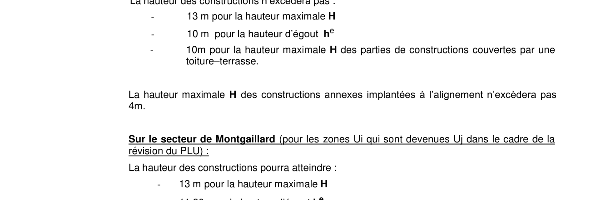
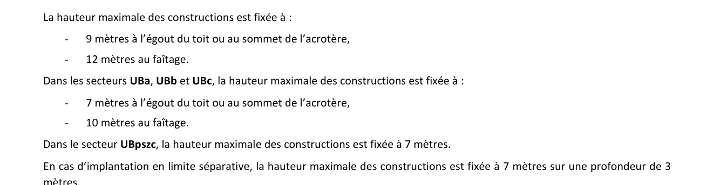

# PLU-MAJ-2 — sondage de 10 règles (graine fixe 20262115)

Dix règles chiffrées tirées au hasard (graine fixe, donc reproductible) parmi les règles calibrées `valide` des communes mises à jour (Saint-Denis `97411_PLU_20260805`, La Possession `97408_PLU_20260625`). Chacune est prouvée par l'IMAGE de la ligne de la page officielle du règlement opposable + la citation mot pour mot.

> Rejouer : `PYTHONPATH=src <venv>/python scripts/plu_maj_2_sondage.py`

---

### 1. Saint-Denis — zone Ua — retraits.entre_constructions

- **Valeur calibrée** : `forme=relative, base_hauteur=cumulee, fraction_hauteur=0.3333, min_m=2`
- **Article** : Article Ua.8 · **page PDF** : 79 (ligne)
- **Citation (mot pour mot)** : « Deux bâtiments non contigus, implantés sur une même propriété, devront respecter entre eux, une distance L supérieure ou égale au tiers de la somme des hauteurs des façades en vis-à-vis et/ou des niveaux droits en vis-à-vis avec un minimum de 2m : 2m ≤ L ≥ H+h /3. »

### 2. Saint-Denis — zone Uj — hauteur.faitage

- **Valeur calibrée** : `m=13`
- **Article** : Article Uj.10 · **page PDF** : 62 (ligne)
- **Citation (mot pour mot)** : « 13 m pour la hauteur maximale H »

### 3. Saint-Denis — zone Ua — emprise_sol.ces

- **Valeur calibrée** : `pct=70`
- **Article** : Article Ua.9 · **page PDF** : 79 (ligne)
- **Citation (mot pour mot)** : « L’emprise au sol des constructions est limitée à 70% de la superficie de l’unité foncière. »

### 4. La Possession — zone UB — hauteur.faitage

- **Valeur calibrée** : `m=12.0, exceptions=[{'texte': 'La hauteur maximale des constructions est fixée à : [...] - 12 mètres au faîtage. Dans les secteurs UBa, UBb et UBc, la hauteur maximale des constructions est fixée à : [...] - 10 mètres au faîtage. Dans le secteur UBpszc, la hauteur maximale des constructions est fixée à 7 mètres.', 'article': 'UB 10.2', 'page_pdf': 31, 'porte': 'sous_secteur', 'modifie_calcul': True}]`
- **Article** : UB 10.2 · **page PDF** : 31 (ligne)
- **Citation (mot pour mot)** : « La hauteur maximale des constructions est fixée à : - 9 mètres à l’égout du toit ou au sommet de l’acrotère, - 12 mètres au faîtage. »

### 5. Saint-Denis — zone Uh — mixite

- **Valeur calibrée** : `seuil_logements=30, quota_pct=15, portee=zone`
- **Article** : Article Uh.2 · **page PDF** : 71 (ligne)
- **Citation (mot pour mot)** : « les opérations nouvelles d'habitat collectif de 30 logements et plus sous réserve qu’elles comportent un minimum de 15% de logements sociaux et/ou intermédiaires dans le respect de la mixité sociale. »

### 6. Saint-Denis — zone Uu — hauteur.faitage

- **Valeur calibrée** : `absent=True`
- **Article** : Article Uu.10 · **page PDF** : 49 (ligne)
- **Citation (mot pour mot)** : « La hauteur maximale des constructions n’est pas réglementée. »

### 7. Saint-Denis — zone Uj — hauteur.egout

- **Valeur calibrée** : `m=10`
- **Article** : Article Uj.10 · **page PDF** : 62 (ligne)
- **Citation (mot pour mot)** : « 10 m pour la hauteur d’égout he »

### 8. La Possession — zone AUB — hauteur.egout

- **Valeur calibrée** : `m=9.0, exceptions=[{'texte': "La hauteur maximale des constructions est fixée à : - 9 mètres à l'égout du toit ou au sommet de l'acrotère, - 12 mètres au faîtage. Dans les secteurs UBa, UBb et UBc, la hauteur maximale des constructions est fixée à : - 7 mètres à l'égout du toit ou au sommet de l'acrotère, - 10 mètres au faîtage. Dans le secteur UBpszc, la hauteur maximale des constructions est fixée à 7 mètres.", 'article': 'UB 10.2', 'page_pdf': 31, 'porte': 'sous_secteur', 'modifie_calcul': True}]`
- **Article** : UB 10.2 · **page PDF** : 31 (ligne)
- **Citation (mot pour mot)** : « La hauteur maximale des constructions est fixée à : - 9 mètres à l’égout du toit ou au sommet de l’acrotère, - 12 mètres au faîtage. »

### 9. La Possession — zone UB — hauteur.egout

- **Valeur calibrée** : `m=9.0, exceptions=[{'texte': "La hauteur maximale des constructions est fixée à : - 9 mètres à l'égout du toit ou au sommet de l'acrotère, - 12 mètres au faîtage. Dans les secteurs UBa, UBb et UBc, la hauteur maximale des constructions est fixée à : - 7 mètres à l'égout du toit ou au sommet de l'acrotère, - 10 mètres au faîtage. Dans le secteur UBpszc, la hauteur maximale des constructions est fixée à 7 mètres. En cas d'implantation en limite séparative, la hauteur maximale des constructions est fixée à 7 mètres sur une profondeur de 3 mètres. La hauteur maximale des constructions annexes est fixée à 3,50 mètres.", 'article': 'UB 10.2', 'page_pdf': 31, 'porte': 'sous_secteur', 'modifie_calcul': True}]`
- **Article** : UB 10.2 · **page PDF** : 31 (ligne)
- **Citation (mot pour mot)** : « La hauteur maximale des constructions est fixée à : - 9 mètres à l’égout du toit ou au sommet de l’acrotère, - 12 mètres au faîtage. »

### 10. La Possession — zone AUB — retraits.limites_separatives

- **Valeur calibrée** : `min_m=3, raison=valeur 4.5 absente de la citation (harmonisation ≠ texte), formule=H/2, minimum 3 m`
- **Article** : UB 7 · **page PDF** : 30 (ligne)
- **Citation (mot pour mot)** : « En cas de retrait de la construction, la distance comptée horizontalement de tout point de la façade au point le plus proche de la limite séparative, doit être au moins égale à la moitié de la hauteur à l’égout du toit de la façade concernée (H/2) sans pouvoir être inférieure à 3 mètres. »

